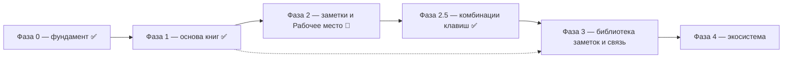

# ROADMAP — Контекст

Стратегический план продукта. Это **источник истины по направлению и
приоритетам**, а не описание текущего состояния. Текущее состояние фиксируют
`openspec/specs/`, конкретные задачи — `openspec/changes/`.

Устройство проекта — каркас, приложение и плагины, их типы и права — описывает
`CONCEPT.md`. Перед планированием сверяться и с ним: направление не должно
расходиться с концепцией.

## Как пользоваться

1. Перед планированием свериться с этим файлом: выбрать домен и этап.
2. Из пункта этапа создать OpenSpec-изменение (`openspec/changes/<change>/`
   с `proposal.md`, `design.md`, `tasks.md`).
3. После реализации и archive изменение обновляет `openspec/specs/`, а в этом
   файле отмечается прогресс этапа.

Статусы: ✅ закрыто · 🚧 есть, но требует доработки · ⏭️ дальше · 💤 позже ·
❓ не решено. Закрыты Фазы 0 и 1; остальные — в работе или впереди.

## Видение

**Контекст — инструмент исследователя книг.** Читать можно по-разному: роман
читается линейно, от начала к концу, а справочник, инструкцию, научную или
философскую работу так читать нельзя — их читают медленно, в разном направлении,
с разных мест, с возвратами и сопоставлениями. Такое чтение неотделимо от
заметок. Инструмент существует, чтобы вести исследование текста: держать книги,
вести заметки и сводить их в одном рабочем месте.

Инструмент состоит из каркаса и четырёх содержательных частей.

1. **Каркас** — приложение, расширяемое плагинами: базовыми (настройки, стор,
   единый интерфейс) и внешними, пользовательскими; в
   перспективе — SDK для сторонних авторов.
2. **Библиотека книг** — пространство книг. Открывает набор книг, умеет искать,
   фильтровать и делать подборки, открывать разные подборки в разных вкладках, в
   перспективе — LLM-поиск. Имеет **страницу книги** с информацией о книге и
   возможностью её редактировать: название, авторы, год, теги и прочие поля.
3. **Рабочее место** — точка сборки книги и заметок: **браузер с вкладками**, где
   открываются разные книги и разные варианты их просмотра. Вкладка — открытая
   книга со своей позицией, масштабом и режимом чтения; заметки ведутся в том же
   месте. **Заметка привязана к книге, а не к вкладке**: одну книгу можно открыть
   в разных рабочих местах и получить одни и те же, пополняемые отовсюду заметки;
   разные части одной книги сравниваются соседними вкладками. Рабочих мест много:
   это именованные сохраняемые композиции, их список — точка входа приложения.
   Рабочее место **ссылается** на книги и заметки, но не хранит их. Для каждого
   формата чтение обеспечивает плагин рабочего места с **унифицированным
   функционалом**.
4. **Библиотека заметок** — пространство заметок: отдельный реестр **наборов
   заметок** к разным книгам со своим поиском и вкладками-подборками. Позволяет
   делиться наборами: принять чужой набор к книге, импортировать его себе и иметь
   одновременно свои и чужие — искать, отображать и организовывать их.

**Точка сборки — Рабочее место.** С одной стороны к нему приходят книги, с
другой — заметки (свои и чужие наборы), и в нём исследователь получает всё
нужное. Ради этой встречи строится всё остальное; каталог, поиск и источники книг
— обслуживающая инфраструктура. Библиотеки книг и заметок — **хранилища**;
рабочее место — **сохранённая композиция** поверх них: оно ссылается на книги и
заметки, но не владеет ими. Главный экран приложения — список рабочих мест.
С книгами и заметками работают одинаково (хранение + поиск + организация), но
пространства существуют отдельно.

Приложение поддерживает **несколько библиотек** одновременно: пользователь
открывает разные (свою, calibre, другие источники) и легко переключается.

## Термины

- **Книга** — единица пространства книг: конкретное произведение в конкретном
  файле или издании.
- **Страница книги** — экран информации о книге и действий с ней; здесь
  редактируются метаданные (название, авторы, год, теги и др.).
- **Подборка** — именованное подмножество книг или наборов заметок, собранное по
  правилу или вручную.
- **Рабочее место** — именованная сохраняемая композиция для исследования: список
  вкладок и ведение заметок. Ссылается на книги и заметки, не владея ими.
- **Вкладка** — открытая в рабочем месте книга со своей позицией, масштабом и
  режимом чтения. Разные части одной книги — соседние вкладки одной книги.
- **Вложение** — то, на что указывает вкладка: книга из библиотеки или
  произвольный файл.
- **Заметка** — запись исследователя, привязанная к месту в книге.
- **Набор заметок** — именованная совокупность заметок к **одной книге**;
  основная единица организации, переключения, поиска и обмена.
- **Библиотека заметок** — отдельный реестр всех наборов заметок по всем книгам;
  поиск, подборки, обмен.
- **Каркас** — приложение-оболочка и базовые сервисы, не зависящие от книги.
- **Плагин рабочего места** — плагин, дающий чтение и заметки для конкретного
  формата книги с унифицированным функционалом.

## Принципы

- **Нелинейное чтение — главный сценарий.** Инструмент рассчитан на чтение с
  разных мест и в разном направлении, а не только на последовательное прочтение.
- **Рабочее место — точка сборки.** Читалка и редактор заметок — одно место;
  заметки создаются и используются там, где читается книга.
- **Рабочее место — браузер вкладок и композиция.** Вкладки открывают разные
  книги и разные варианты просмотра; рабочее место ссылается на книги и заметки,
  а не хранит их; рабочих мест много, и их список — точка входа приложения.
- **Заметки привязаны к книге, а не к вкладке.** Одну книгу можно вести из разных
  рабочих мест и видеть общее, пополняемое отовсюду состояние заметок.
- **Заметки организованы наборами.** Единица заметок — набор к книге; наборы
  переключаются, ищутся и переносятся, свои и чужие сосуществуют.
- **Симметрия пространств.** Книги и заметки — равноправные коллекции со своим
  хранением, поиском и организацией.
- **Заметки хранятся отдельно от книги.** Привязаны к ней, но переносимы.
- **Рабочее место — плагин на формат.** Единый функционал чтения и заметок
  реализуется отдельно для каждого формата. Плагин рабочего места **рисует только
  область содержимого**; управление и оформление страницы — у приложения.
- **Единая дизайн-система неприкосновенна.** Оформление и управление контролирует
  приложение: единообразие и предсказуемость важнее свободы плагинов, потому что
  приложение существует ради удобства, а богатое и неудобное никому не нужно.
  Отсюда — отказ от фронтенда в обычных плагинах и узкое исключение только для
  рисования содержимого.
- **Источник не знает о совместимости.** Generic-источник сканирует директорию
  книг и анализирует их сам; совместимость с конкретным менеджером (calibre и
  др.) — отдельный явный плагин поверх общего.
- **Индекс в SQLite.** Локальный каталог — реляционная БД, пригодная для
  сложного поиска и фильтрации; JSON для этого бесперспективен.
- **Plugin-first.** Формат книги, способ чтения, привязка заметок, источники —
  в плагинах; ядро не знает о форматах, структурах и конкретных источниках.
- **Local-first и портируемость.** Библиотека и заметки переносимы, без облака.
- **Opaque-контракты ядра.** Ядро не интерпретирует модели плагинов, а
  маршрутизирует их.
- **Опциональность тяжёлого.** LLM, сетевые сервисы, внешние редакторы — плагины.

## Режимы интерфейса (адаптивность)

Раскладка выбирается **единой шкалой** по ширине окна. Каждый режим — это
конкретная ширина, а не «примерно планшет»: по одному порогу решается и
раскладка (Tailwind), и поведение в скрипте (`matchMedia`). Разные пороги в
разных местах запрещены — именно они заставляли элементы «плясать» и
переноситься вразнобой.

| № | Режим | Ширина | Что это значит |
| --- | --- | --- | --- |
| 1 | **Смартфон** | до 768px (`< 48rem`) | Одна колонка, нижняя навигация, полосы управления в несколько строк, укороченная постраничность, сенсорные цели. Подступень до 480px (`< 30rem`): совсем узкий экран, где прячутся подписи и лишние номера страниц. |
| 2 | **Маленький планшет** | 768–1023px (`48rem–63.99rem`) | Нижняя навигация ещё допустима; двухколоночная раскладка там, где есть место; полосы управления в одну-две строки. |
| 3 | **Большой планшет** | 1024–1439px (`64rem–89.99rem`) | Верхняя навигация, полные полосы управления в одну строку, панели раздела рядом с содержимым. |
| 4 | **Десктоп** | 1440–1919px (`90rem–119.99rem`) | Базовый десктопный набор: шкала размеров +25%, предел ширины контента 1600px. |
| 5 | **Крупный десктоп** | 1920–2559px (`120rem–159.99rem`) | Шкала +50%, предел контента 1840px, панели шире. |
| 6 | **Очень крупный десктоп** | от 2560px (`≥ 160rem`) | Дальше шкала не растёт: контент держит предел ширины, растёт только свободное поле. |

Примечание: в задаче сказано «5 режимов», но названий перечислено шесть —
в таблице зафиксированы все шесть.

**Состояние после приведения.** Все области используют одну шкалу: утилиты
`phone:`, `tablet:`, `large-tablet:`, `desktop:`, `large-desktop:`,
`huge-desktop:` и парные `max-large-tablet:`; стандартные `sm:`/`lg:` и
произвольные `min-[…]` из областей убраны. Смена компоновки (навигация, боковые
панели, панель чтения, полосы управления) идёт по одному порогу —
`large-tablet` (1024px).

### Задачи приведения интерфейса к режимам

- [x] **`responsive-modes`**: ввести единые пороги (см. таблицу) в токенах и
  `breakpoints.ts`; лишние убрать (`MOBILE_MAX_WIDTH`, `WIDE_MIN_WIDTH`,
  `ULTRA_MIN_WIDTH`), `PHONE_MAX_WIDTH` свести к подступени смартфона.
- [x] Заменить стандартные утилиты (`sm:`, `lg:`, `wide:`, `ultra:`) и
  произвольные пороги (`min-[34rem]`, `min-[30rem]`) на именованные по режимам:
  ни один компонент не выбирает ширину «на глаз».
- [x] Привести к режимам полосы управления разделов (книги, список библиотек,
  заметки, рабочие места): одинаковый порядок элементов, одинаковое
  выравнивание, отсутствие переносов на соседних режимах.
- [x] Привести к режимам постраничность, сортировку, переключатели вида и
  фильтры: одинаковый набор управления и одинаковое положение на всех режимах.
- [x] Привести к режимам навигацию и панели (шапка, нижняя навигация, боковые
  панели, панели чтения): смена компоновки — строго по одному порогу.
- [x] Добавить проверку для ширин 360, 480, 767, 768, 1023, 1024, 1439, 1440,
  1919, 1920, 2559, 2560: нет горизонтальной прокрутки, а основание элементов
  управления не смещается при появлении и исчезновении соседних блоков.

## Домены

| Слой | Домен | Возможности | Статус |
| --- | --- | --- | --- |
| Фундамент | Plugin-system, shell, настройки, файловый стор | `plugin-system`, `app-shell`, `settings`, `plugin-store` | ✅ |
| Фундамент | Декларативный UI плагинов и SDK: пространства, рендерер, контракт | `plugin-ui`, `plugin-sdk` | ✅ |
| Фундамент | Информация о приложении: версия и расположение служебных конфигов и кешей | `app-info` | ✅ |
| Фундамент | Служебные файлы состояния: реестр и форматы (JSON/TOML) | `app-state` | ✅ |
| Фундамент | Спецификации служебных JSON-документов и кешей (`plugin-manifest.json` и др.): схемы, метки `format`, версии, проверка при чтении и записи | `config-schemas` | ✅ JSON (SQLite/TOML — дальше) |
| Пространство книг | Generic источник «директория книг» (скан/анализ своих правил) | `books-source` | ✅ |
| Пространство книг | Calibre-совместимость (явный отдельный плагин) | `calibre-source` | ✅ |
| Пространство книг | Локальный каталог и индекс на SQLite: общая схема каталога в SDK с версионными миграциями, свойства книги (язык, дата выхода, издатель, ISBN, описание, размер, дата добавления), обложки пакетом | `library-index` | ✅ |
| Пространство книг | Несколько библиотек и переключение | `library-manager` | ✅ |
| Пространство книг | Страница книги: свойства из источника и правка пользователем (название, авторы, язык, дата, издатель, идентификатор, теги) | `book-page` | ✅ |
| Пространство книг | Подборки и поиск: поиск источника, сортировка по свойствам и фасетные фильтры | `collections`, `search` | 🚧 поиск, сортировка и фильтры есть; подборок нет |
| Пространство книг | Свойства книги: слой источника (индекс) и слой пользователя (правки и теги в отдельном документе приложения), переживающем пересборку индекса | `book-properties` | ✅ |
| Пространство книг | Вкладки: разные подборки/списки книг в отдельных вкладках | `library-tabs` | 💤 |
| Пространство книг | Открытие книги в рабочее место: передача абсолютного пути и поддержка форматов | `library-ui` | ✅ |
| Пространство заметок | Наборы заметок: модель и хранение, привязка к книге | `notes-store` | ✅ |
| Пространство заметок | Библиотека заметок: реестр наборов, поиск, подборки/вкладки | `notes-library` | ✅ реестр + поиск (подборки/вкладки — дальше) |
| Пространство заметок | Импорт/экспорт и обмен наборами | `notes-io` | ⏭️ |
| Пространство заметок | Блокнот рабочего места: общий на всё место, со ссылками на заметки книг | `workspace-notebook` | 💤 понижен в приоритете |
| Точка встречи | Рабочее место: чтение книги (reader) | `reader` | ✅ |
| Точка встречи | Поиск по содержимому книги: вхождение с подсветкой и переходом, во встроенном чтении и плагинах форматов | `reader` | ✅ |
| Точка встречи | Редактор заметок: заметки-цитаты выделением на странице, точное восстановление, подсветка, список | `editor` | ✅ |
| Точка встречи | Рабочее место — реестр рабочих мест: хранение, недоступные книги, переносимость | `workspace-manager` | 🚧 нет переносимости |
| Точка встречи | Браузер вкладок: разные книги и варианты просмотра, позиции, масштаб, панель открытых вкладок книг | `reading-workspace` | ✅ |
| Точка встречи | Свойства файла: содержание текучих книг, встроенные закладки PDF/DjVu, превью страниц, встроенные пометки PDF по запросу | `reader-plugins` | ✅ |
| Точка встречи | Плагины рабочего места: форматы, где содержимое рисует плагин (управление — приложение) | `reader-plugins` | 🚧 |
| Точка встречи | Система комбинаций клавиш: реестр действий и привязок, внедрение по всему функционалу | `hotkeys` | ✅ |
| Точка встречи | Идентификация книги → привязка заметок | `book-identity` | ❓ |
| Экосистема | Темы оформления (тема светлая/тёмная/системная, палитры «Туман»/«Лён»/«Иней»/«Янтарь» и переключатель в шапке — закрыта база `app-theme`; **тема области чтения** — независимая сторона палитры, закрыта `reader-theme`; внешние палитры — впереди) | `themes` | 🚧 |
| Экосистема | Проверка новых версий и автообновление приложения (файловый и сетевой источник, ядро целиком) | `app-update` | 🚧 |
| Экосистема | Сетевой стор плагинов (обновление по частям; подпись пакетов — следующий шаг) | `plugin-store` (расширение) | 🚧 |
| Экосистема | LLM-поиск, новые форматы | `search` (расширение), `reader` (расширение) | 💤 |

## Незавершённое (техдолг, блокирует продвижение)

- Модель **набора заметок** и хранилище есть, реестр заметок с глобальным поиском
  реализован (`notes-library`, реестр + поиск). Остаются подборки/вкладки заметок
  и обмен наборами (`notes-io`) — следующими шагами. Без них Рабочее место
  неполно.
- Чтение рабочего места **не зависит от открытой библиотеки**: вложение вкладки —
  путь к файлу, чтение идёт отдельным runtime ядра. Прежний техдолг «связь
  рабочего места с библиотекой» закрыт по части вложения; остаётся переносимость
  рабочих мест (экспорт/импорт).
- Механизм **плагина формата чтения** (прежнее имя — плагин рабочего места) введён
  (`workplace-content-plugins`) и проверен первым рисующим форматом PDF
  (`reader-pdf`: плагин `format-pdf`). Остаётся: установка сторонних плагинов
  формата чтения из стора и общий модуль рисования, а также новые форматы (Фаза 4).
- Страница книги только показывает информацию: нет редактирования метаданных
  (название, авторы, год, теги) и нет подборок книг. Поиск по индексу уже есть.
- Декларативный UI для **сторонних** плагинов (`packages/ui-schema`) с рендером
  компонентами `@context/ui` реализован: первое пространство `settings.section`,
  плагин отдаёт дерево `ui-schema`, оболочка рендерит его обобщённым рендерером и
  присылает интенты; SDK — `src-wasm-sdk/ui-sdk`. Расширение каталога
  пространств и компонентов — отдельный последующий шаг. Исключение — плагины
  рабочего места, рисующие **только** область содержимого книги.
- `_docs/issues/calibre-as-source-plugin.md` устарел (описывает calibre как основу
  переноса из ядра; фактически есть generic-источник `books-source` и отдельный
  `books-source-calibre`). Файл следует переработать или удалить.

## Этапы

### Фаза 0 — фундамент ✅

- Plugin-system, shell, базовые плагины (settings, plugin-store) — есть.
- **Приведение к концепции `CONCEPT.md`** (изменение `framework-app-plugins`):
  каркас и приложение разведены, не-плагины и SDK каркаса вынесены в
  `src-wasm-sdk/`, у плагина три независимые оси (назначение, уровень, область
  загрузки), имена приведены к предмету (`books-source`, `books-source-calibre`,
  `format-pdf`, `format-djvu`). ✅
- Файловый стор плагинов: базовый плагин `plugin-store` устанавливает и удаляет
  zip-пакеты в пользовательский каталог, ведёт реестр сторов и заглушку сетевого
  провайдера; UI стора — встроенная область оболочки `StorePage.svelte`.
- Сетевой стор и **подпись/проверка пакетов** — следующий шаг Фазы 4.

**Выход:** каркас приложения, базовые плагины и установка плагинов из файла.

### Фаза 1 — надёжная основа пространства книг (остался `config-schemas`)

- `books-source`: generic-источник `books-source` — сканирует произвольную директорию
  книг и сам анализирует структуру и файлы, строит каталог. Не знает о calibre. ✅
- `calibre-source`: отдельный плагин `books-source-calibre` — подтверждает только
  директории с `metadata.db`, раскладка «<автор>/<книга>». ✅
- `library-index`: локальный каталог/индекс на SQLite (сложный поиск и
  фильтрация). ✅
- `library-manager`: несколько библиотек в одном приложении и быстрое
  переключение между ними (реестр `library-history`, `select_source_library`,
  страница «Библиотеки»). ✅
- `app-info`: страница «Информация» в настройках — версия приложения и
  расположение служебных конфигов и кешей. ✅
- `config-schemas`: спецификации всех служебных конфигов и кешей (в том числе
  `plugin-manifest.json`) — чтобы технически проверять их корректность и явно
  описывать, на что рассчитывать разработчику (поля, обязательность, значения по
  умолчанию, версия контракта). Часть работы уже сделана изменением
  `app-state-files` (реестр и форматы файлов состояния, спека `app-state`);
  остаётся машинно-проверяемая форма (схемы и валидация) для конфигов плагинов и
  приложения. ⏭️

**Выход:** можно открыть несколько библиотек разных типов, переключаться,
искать и фильтровать по реляционному индексу. — **достигнут**.

### Фаза 2 — пространство заметок и Рабочее место (ядро ценности) 🚧

Закрыта, кроме **блокнота рабочего места** (понижен в приоритете, см. ниже).
`reader`, `editor`, `reading-workspace`, `notes-store`, `notes-library` (реестр +
поиск) — ✅; `workspace-manager` — без переносимости; `reader-plugins` — механизм
есть, установка сторонних плагинов и общий модуль рисования впереди.

- `notes-store`: модель и хранение **наборов заметок** отдельно от книги; заметка
  привязана к месту в книге, набор — к книге. ✅
- `notes-library`: реестр наборов заметок по всем книгам, группировка по книге,
  глобальный поиск, переход к книге/заметке. ✅ (реестр + поиск; подборки/вкладки
  и обмен наборами — `notes-io`)
- `reader-plugins`: механизм плагина рабочего места — плагин объявляет форматы и
  рисует **только область содержимого**, управление рисует приложение; приложение
  выбирает плагин по формату, ядро форматов не знает. ✅ (механизм). Модуль
  рисования плагина PDF разрабатывается как **самостоятельный фронтенд-проект**
  плагина (`src-wasm-plugins/format-pdf/frontend/`: свой тулчейн, Vite, тесты)
  и собирается в `viewer/` шагом конвейера плагинов, не разделяя код с оболочкой.
- `reader`: рабочая страница чтения. Читатель выбирается по плагину формата:
  EPUB, FB2, PDF и DjVu обслуживают свои плагины (`format-epub`, `format-fb2`,
  `format-pdf`, `format-djvu`), встроенного чтения форматов в оболочке нет. ✅
  Поиск по содержимому книги идёт по тексту книги: плагин формата ищет по
  главам текучей книги или по текстовому слою страниц (команды
  `search`/`search-step`, ответ `search`); найденное подсвечивается отдельно от
  заметок, переход ведёт по вхождениям по кругу. ✅
- `reader`: **свойства открытого файла** — панель рабочего места с вкладками,
  состав которых задаёт формат. У текучих книг (EPUB, FB2) — содержание из глав
  книги; у страничных (PDF, DjVu) — встроенные закладки файла (`Outlines` /
  чанк `NAVM`), превью страниц по запросу и найденные в PDF пометки. Встроенные
  пометки — аннотации документа: выделения и стикеры с комментарием; они только
  разбираются и показываются в панели, а на странице появляются лишь по нажатию
  (пометка не становится заметкой и файл не меняется). Свойства кэшируются на
  диске ядра (`reader-cache`, свежесть по размеру и времени файла) и при
  повторном открытии вкладки показываются сразу, без повторного разбора и
  отрисовки превью; готовит их только открытая вкладка, а не весь состав
  рабочего места. ✅
- `editor`: ведение заметок в Рабочем месте — создание и правка, привязка к месту,
  **переключение наборов**, поиск внутри набора. ✅
- `workspace-manager`: реестр рабочих мест — создание, открытие, переименование и
  сохранение; недоступные книги с переуказанием пути и сохранением настроек
  вкладки; переносимость (экспорт/импорт) позже; хранение в служебном каталоге
  приложения. 🚧 (без переносимости)
- `reading-workspace`: браузер вкладок — разные книги и разные варианты просмотра
  одной книги, режимы чтения (прокрутка/страницы), масштаб, сохранение позиции,
  панель списка открытых вкладок книг. Главный экран — список рабочих мест. ✅
- `workspace-notebook` (замысел): **блокнот рабочего места** — заметки, не
  привязанные ни к одной книге, общие на всё рабочее место. Наборы заметок
  принадлежат книге; блокнот — это место для мыслей «между книгами»: плана
  чтения, черновиков, выводов по нескольким источникам. Блокнот может
  **ссылаться на заметки и книги** рабочего места, но сами заметки книг не
  заменяет. Владение блокнотом — рабочее место (а не книга), поэтому он
  переживает закрытие книг и виден из любой вкладки. 💤 (понижен в приоритете:
  делается позже, не блокирует библиотеку заметок).

**Выход:** можно держать несколько рабочих мест, открывать в них множество книг
вкладками, читать и вести общие для книги заметки в разных наборах, не теряя
состояние открытия.

### Фаза 2.5 — система комбинаций клавиш ✅

- `hotkeys`: реестр действий и привязок комбинаций клавиш с единым внедрением по
  всему функционалу (разделы, панели рабочего места, вкладки, масштаб, поиск,
  прокрутка книги, закрытие слоёв). Сделано ядро: каталог действий, реестр с
  проверкой конфликтов (одно сочетание — одно действие во всём приложении),
  единый диспетчер с одним слушателем `keydown`, защита от ввода текста и от
  чужих прокручиваемых списков. Книга не трактует клавиши по месту: встроенное
  чтение пересылает нажатие, плагины форматов распознают его по присланным
  привязкам и сообщают действие, а выполняет его приложение. Остаётся
  настраиваемость: переопределение привязок пользователем (реестр уже принимает
  переопределения, интерфейса и хранения в настройках пока нет).

### Фаза 3 — связь, библиотека заметок и переносимость

- `book-identity`: устойчивый идентификатор книги по косвенным признакам
  (хеши содержимого, метаданные, fuzzy) → заметки не теряются при смене файла
  или издания.
- `notes-library` (подборки/вкладки) и `notes-io`: объединение наборов в подборки,
  импорт/экспорт и обмен наборами — свои и чужие сосуществуют.
- `book-page`, `catalog`, `collections`, `search`: редактирование метаданных,
  теги/подборки, вкладки подборок книг, единый поиск.

**Выход:** заметки привязаны к произведению, переносимы, находятся и передаются;
библиотека пригодна как каталог.

### Фаза 4 — экосистема

- `reader-plugins`: рабочие места для новых форматов (MOBI, EPUB-фикс и др.) с
  единым функционалом; PDF уже поддержан (`format-pdf`).
- `themes`: темы оформления интерфейса и Рабочего места.
- `app-update`: проверка новых версий приложения и автообновление. Ядро
  (приложение и каркасные плагины) обновляется одним пакетом из одного
  источника; прикладные плагины — по отдельности через стор. Поддержаны
  файловый и сетевой источники, проверка SHA-256, режимы `portable`,
  `appimage` и `installer`, проверка при запуске с диалогом установки и
  перезапуском. 🚧 (подпись пакетов издателя — следующий шаг перед публичным
  сетевым стором.)
- `plugin-store`: сетевой стор плагинов. Установка, обновление и проверка
  версий прикладных плагинов из файловых и сетевых источников работают; перед
  публичным запуском включить **подпись пакетов и проверку
  целостности/доверия** издателю. 🚧
- `search` + LLM: семантический индекс (опциональный плагин).
- `plugin-ui` + `plugin-sdk`: декларативный UI и SDK для сторонних авторов.

## Не-цели

- Повторять или копировать Calibre; совместимость с ней — опциональный плагин.
- Облачная синхронизация и аккаунты.
- Обязательная интернет-зависимость для базовых функций.
- Собственный формат книги — работаем с существующими форматами.
- Монетизация/магазин плагинов на текущем горизонте.

## Открытые вопросы

- ❓ **Кто владеет SQLite-индексом.** Ядро предоставляет БД, а плагин только
  отдаёт данные, или плагин получает SQLite host API. Текущие спеки говорят
  «индексом владеет плагин» — конфликтует со SQLite-хранилищем.
- ❓ **Модель мультибиблиотечности.** Реестр библиотек, переключение; как к этому
  привязаны заметки — общие для всех библиотек или у каждой свои.
- ❓ **Граница reader ↔ editor ↔ notes-store.** Что в плагине чтения, что в
  редакторе заметок, а что в общем хранилище наборов.
- ❓ **Идентичность набора заметок и обмен.** Как набор адресуется для передачи
  (идентификатор, автор, версия), как отличать свой набор от чужого.
- ❓ **Формат набора заметок.** Отдельный файл рядом с книгой vs хранилище
  библиотеки vs экспорт в Markdown/Obsidian-совместимое.
- ❓ **Идентификация книги.** Основной ключ и разрешение коллизий; к чему
  привязывается набор — к произведению или к конкретному файлу/изданию.
- ❓ **Хранение и связь рабочего места с библиотеками.** Реестр рабочих мест живёт
  в служебном каталоге приложения; вкладка адресует книгу **путём к файлу** и не
  зависит от открытой библиотеки. Открыт вопрос переносимости рабочих мест
  (экспорт/импорт) и поведения при переезде файлов.
- ❓ **Связь «библиотека ↔ рабочее место» (многие ко многим).** В рабочем месте
  выбирают книги (библиотека или произвольный путь), в библиотеке выбирают
  рабочее место для открытия книги. Плагин-связка vs мини-поиск источников на
  обеих сторонах; путь-вложение уже снимает необходимость открытой библиотеки.
- ❓ **Выбор набора заметок.** На книгу (общий для всех её вкладок) или на вкладку
  — решено: **на книгу** через ключ `bookKey(path)`; открыт вопрос смены ключа на
  стабильную идентификацию (`book-identity`).
- ❓ **Модель вкладок Библиотеки.** Как устроены вкладки подборок и сохраняются ли
  они между запусками.
- ❓ **Оформление списка книг (книги — отдельная забота).** Список книг библиотеки
  богат (обложка, название, авторы, действия) и пока оставлен как есть. Нужны **два
  привычных режима показа — «список» и «плитка»**, как это обычно делают; делать
  это следует отдельным изменением, не трогая остальные страницы-списки. Памятка
  внесена при унификации страниц-списков (изменение `unified-list-pages`).
- ✅ **Интернационализация интерфейса (i18n).** Выбор языка (русский и
  английский) живёт в настройке `appearance.language`, читается на бутстрапе и
  применяется без перезапуска; тексты — в словарях пакета `@context/i18n`,
  даты следуют выбранному языку. Связано с оформлением единого пункта списка
  (`unified-list-pages`). Дальше — добавление языков и перевод сообщений
  ядра/плагинов, которые пока остаются русскими.
- ❓ **LLM-стек.** Локальная модель vs внешний провайдер, где живёт индекс.

