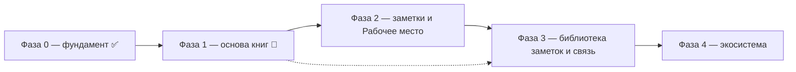

# ROADMAP — Текстура

Стратегический план продукта. Это **источник истины по направлению и
приоритетам**, а не описание текущего состояния. Текущее состояние фиксируют
`openspec/specs/`, конкретные задачи — `openspec/changes/`.

## Как пользоваться

1. Перед планированием свериться с этим файлом: выбрать домен и этап.
2. Из пункта этапа создать OpenSpec-изменение (`openspec/changes/<change>/`
   с `proposal.md`, `design.md`, `tasks.md`).
3. После реализации и archive изменение обновляет `openspec/specs/`, а в этом
   файле отмечается прогресс этапа.
4. Смысловые развилки фиксировать в «Журнале решений» — чтобы не пересматривать
   их заново.

Статусы: ✅ закрыто · 🚧 есть, но требует доработки · ⏭️ дальше · 💤 позже ·
❓ не решено. Закрыта Фаза 0; остальные — в работе или впереди.

## Видение

**Текстура — инструмент исследователя книг.** Читать можно по-разному: роман
читается линейно, от начала к концу, а справочник, инструкцию, научную или
философскую работу так читать нельзя — их читают медленно, в разном направлении,
с разных мест, с возвратами и сопоставлениями. Такое чтение неотделимо от
заметок. Инструмент существует, чтобы вести исследование текста: держать книги,
вести заметки и сводить их в одном рабочем месте.

Инструмент состоит из каркаса и четырёх содержательных частей.

1. **Каркас** — приложение, расширяемое плагинами: базовыми (уведомления,
   настройки, стор, единый интерфейс) и внешними, пользовательскими; в
   перспективе — SDK для сторонних авторов.
2. **Библиотека книг** — пространство книг. Открывает набор книг, умеет искать,
   фильтровать и делать подборки, открывать разные подборки в разных вкладках, в
   перспективе — LLM-поиск. Имеет **страницу книги** с информацией о книге и
   возможностью её редактировать: название, авторы, год, теги и прочие поля.
3. **Рабочее место** — точка сборки книги и заметок: **браузер с вкладками**, где
   открываются разные книги и разные варианты их просмотра. Вкладка — открытая
   книга со своей позицией, масштабом и режимом чтения; заметки ведутся в том же
   месте. **Заметка привязана к книге, а не к вкладке**: одну книгу можно открыть
   в разных рабочих местах и получить одни и те же, пополняемые отовсюду заметки;
   разные части одной книги сравниваются соседними вкладками. Рабочих мест много:
   это именованные сохраняемые композиции, их список — точка входа приложения.
   Рабочее место **ссылается** на книги и заметки, но не хранит их. Для каждого
   формата чтение обеспечивает плагин рабочего места с **унифицированным
   функционалом**.
4. **Библиотека заметок** — пространство заметок: отдельный реестр **наборов
   заметок** к разным книгам со своим поиском и вкладками-подборками. Позволяет
   делиться наборами: принять чужой набор к книге, импортировать его себе и иметь
   одновременно свои и чужие — искать, отображать и организовывать их.

**Точка сборки — Рабочее место.** С одной стороны к нему приходят книги, с
другой — заметки (свои и чужие наборы), и в нём исследователь получает всё
нужное. Ради этой встречи строится всё остальное; каталог, поиск и источники книг
— обслуживающая инфраструктура. Библиотеки книг и заметок — **хранилища**;
рабочее место — **сохранённая композиция** поверх них: оно ссылается на книги и
заметки, но не владеет ими. Главный экран приложения — список рабочих мест.
С книгами и заметками работают одинаково (хранение + поиск + организация), но
пространства существуют отдельно.

Приложение поддерживает **несколько библиотек** одновременно: пользователь
открывает разные (свою, calibre, другие источники) и легко переключается.

## Термины

- **Книга** — единица пространства книг: конкретное произведение в конкретном
  файле или издании.
- **Страница книги** — экран информации о книге и действий с ней; здесь
  редактируются метаданные (название, авторы, год, теги и др.).
- **Подборка** — именованное подмножество книг или наборов заметок, собранное по
  правилу или вручную.
- **Рабочее место** — именованная сохраняемая композиция для исследования: список
  вкладок и ведение заметок. Ссылается на книги и заметки, не владея ими.
- **Вкладка** — открытая в рабочем месте книга со своей позицией, масштабом и
  режимом чтения. Разные части одной книги — соседние вкладки одной книги.
- **Вложение** — то, на что указывает вкладка: книга из библиотеки или
  произвольный файл.
- **Заметка** — запись исследователя, привязанная к месту в книге.
- **Набор заметок** — именованная совокупность заметок к **одной книге**;
  основная единица организации, переключения, поиска и обмена.
- **Библиотека заметок** — отдельный реестр всех наборов заметок по всем книгам;
  поиск, подборки, обмен.
- **Каркас** — приложение-оболочка и базовые сервисы, не зависящие от книги.
- **Плагин рабочего места** — плагин, дающий чтение и заметки для конкретного
  формата книги с унифицированным функционалом.

## Принципы

- **Нелинейное чтение — главный сценарий.** Инструмент рассчитан на чтение с
  разных мест и в разном направлении, а не только на последовательное прочтение.
- **Рабочее место — точка сборки.** Читалка и редактор заметок — одно место;
  заметки создаются и используются там, где читается книга.
- **Рабочее место — браузер вкладок и композиция.** Вкладки открывают разные
  книги и разные варианты просмотра; рабочее место ссылается на книги и заметки,
  а не хранит их; рабочих мест много, и их список — точка входа приложения.
- **Заметки привязаны к книге, а не к вкладке.** Одну книгу можно вести из разных
  рабочих мест и видеть общее, пополняемое отовсюду состояние заметок.
- **Заметки организованы наборами.** Единица заметок — набор к книге; наборы
  переключаются, ищутся и переносятся, свои и чужие сосуществуют.
- **Симметрия пространств.** Книги и заметки — равноправные коллекции со своим
  хранением, поиском и организацией.
- **Заметки хранятся отдельно от книги.** Привязаны к ней, но переносимы.
- **Рабочее место — плагин на формат.** Единый функционал чтения и заметок
  реализуется отдельно для каждого формата. Плагин рабочего места **рисует только
  область содержимого**; управление и оформление страницы — у приложения.
- **Единая дизайн-система неприкосновенна.** Оформление и управление контролирует
  приложение: единообразие и предсказуемость важнее свободы плагинов, потому что
  приложение существует ради удобства, а богатое и неудобное никому не нужно.
  Отсюда — отказ от фронтенда в обычных плагинах и узкое исключение только для
  рисования содержимого.
- **Источник не знает о совместимости.** Generic-источник сканирует директорию
  книг и анализирует их сам; совместимость с конкретным менеджером (calibre и
  др.) — отдельный явный плагин поверх общего.
- **Индекс в SQLite.** Локальный каталог — реляционная БД, пригодная для
  сложного поиска и фильтрации; JSON для этого бесперспективен.
- **Plugin-first.** Формат книги, способ чтения, привязка заметок, источники —
  в плагинах; ядро не знает о форматах, структурах и конкретных источниках.
- **Local-first и портируемость.** Библиотека и заметки переносимы, без облака.
- **Opaque-контракты ядра.** Ядро не интерпретирует модели плагинов, а
  маршрутизирует их.
- **Опциональность тяжёлого.** LLM, сетевые сервисы, внешние редакторы — плагины.

## Домены

| Слой | Домен | Возможности | Статус |
| --- | --- | --- | --- |
| Фундамент | Plugin-system, shell, настройки, уведомления, файловый стор | `plugin-system`, `app-shell`, `settings`, `notifications`, `plugin-store` | ✅ |
| Фундамент | Декларативный UI плагинов и SDK: пространства, рендерер, контракт | `plugin-ui`, `plugin-sdk` | ⏭️ |
| Пространство книг | Generic источник «директория книг» (скан/анализ своих правил) | `books-source` | 🚧 переработка |
| Пространство книг | Calibre-совместимость (явный отдельный плагин) | `calibre-source` | ⏭️ |
| Пространство книг | Локальный каталог и индекс на SQLite | `library-index` | ✅ |
| Пространство книг | Несколько библиотек и переключение | `library-manager` | 🚧 |
| Пространство книг | Страница книги и редактирование метаданных (название, авторы, год, теги) | `book-page` | ⏭️ |
| Пространство книг | Подборки и поиск | `collections`, `search` | ⏭️ |
| Пространство книг | Вкладки: разные подборки/списки книг в отдельных вкладках | `library-tabs` | 💤 |
| Пространство книг | Открытие книги в рабочее место: передача абсолютного пути и поддержка форматов | `library-ui` | ✅ |
| Пространство заметок | Наборы заметок: модель и хранение, привязка к книге | `notes-store` | ✅ |
| Пространство заметок | Библиотека заметок: реестр наборов, поиск, подборки/вкладки | `notes-library` | ⏭️ |
| Пространство заметок | Импорт/экспорт и обмен наборами | `notes-io` | ⏭️ |
| Точка встречи | Рабочее место: чтение книги (reader) | `reader` | 🚧 |
| Точка встречи | Редактор заметок: заметки-цитаты выделением на странице, точное восстановление, подсветка, список | `editor` | 🚧 |
| Точка встречи | Рабочее место — реестр рабочих мест: хранение, недоступные книги, переносимость | `workspace-manager` | 🚧 |
| Точка встречи | Браузер вкладок: разные книги и варианты просмотра, позиции, масштаб, панель открытых книг | `reading-workspace` | ✅ |
| Точка встречи | Плагины рабочего места: форматы, где содержимое рисует плагин (управление — приложение) | `reader-plugins` | ⏭️ |
| Точка встречи | Идентификация книги → привязка заметок | `book-identity` | ❓ |
| Экосистема | Темы оформления | `themes` | 💤 |
| Экосистема | Сетевой стор плагинов (следующий шаг, с подписью пакетов) | `plugin-store` (расширение) | 💤 |
| Экосистема | LLM-поиск, новые форматы | `search` (расширение), `reader` (расширение) | 💤 |

## Незавершённое (техдолг, блокирует продвижение)

- Плагин `library` сканирует структуру «автор/книга» — это частный случай
  (calibre-раскладка). Нужен generic-источник, который анализирует книги сам,
  и отдельный явный `calibre-source` поверх.
- Нет модели нескольких библиотек и переключения между ними.
- Модель **набора заметок** и хранилище есть (`notes-store`: базовый плагин
  `notes.store@1`, наборы в служебном JSON), но нет **библиотеки заметок**
  (реестра, поиска, подборок) и нет обмена наборами. Без них Рабочее место неполно.
- Чтение рабочего места **не зависит от открытой библиотеки**: вложение вкладки —
  путь к файлу, чтение идёт отдельным runtime ядра. Прежний техдолг «связь
  рабочего места с библиотекой» закрыт по части вложения; остаётся переносимость
  рабочих мест (экспорт/импорт).
- Нет механизма **плагина рабочего места**: форматы, требующие рисования (PDF и
  др.), нельзя читать встроенно, читалка привязана к EPUB. Создаётся изменением
  `workplace-content-plugins`.
- Страница книги только показывает информацию: нет редактирования метаданных
  (название, авторы, год, теги) и нет подборок книг.
- Автономные frontend-плагины (`plugins/*`, iframe, `kind: "ui"`, отдельная сборка
  в `public/plugins/`) противоречат единой дизайн-системе: каждый плагин рисует
  свой интерфейс. Подлежат замене: UI первых плагинов переносится в приложение, а
  для сторонних плагинов вводится декларативный UI (`packages/ui-schema`) с
  рендером компонентами `@texture/ui`. Исключение — плагины рабочего места,
  рисующие **только** область содержимого книги.
- `_docs/issues/calibre-as-source-plugin.md` устарел (calibre подан как основа, а
  не как один из источников) — пересмотреть.

## Этапы

### Фаза 0 — фундамент ✅

- Plugin-system, shell, базовые плагины (notifications, settings) — есть.
- Файловый стор плагинов: базовый плагин `plugin-store` устанавливает и удаляет
  zip-пакеты в пользовательский каталог, ведёт реестр сторов и заглушку сетевого
  провайдера; UI — `plugin-store-ui`.
- Сетевой стор и **подпись/проверка пакетов** — следующий шаг Фазы 4.

**Выход:** каркас приложения, базовые плагины и установка плагинов из файла.

### Фаза 1 — надёжная основа пространства книг 🚧

- `books-source`: generic-источник — сканирует произвольную директорию книг и
  сам анализирует структуру и файлы, строит каталог. Не знает о calibre.
- `calibre-source`: отдельный, явно названный плагин совместимости — работает
  строго с calibre (её раскладка и метаданные). Подключается по желанию:
  пользователь ставит плагин, выбирает библиотеку, пользуется.
- `library-index`: локальный каталог/индекс на SQLite (сложный поиск и
  фильтрация), вместо JSON.
- `library-manager`: несколько библиотек в одном приложении и быстрое
  переключение между ними.

**Выход:** можно открыть несколько библиотек разных типов, переключаться,
искать и фильтровать по реляционному индексу.

### Фаза 2 — пространство заметок и Рабочее место (ядро ценности)

- `notes-store`: модель и хранение **наборов заметок** отдельно от книги; заметка
  привязана к месту в книге, набор — к книге.
- `reader-plugins`: механизм плагина рабочего места — плагин объявляет форматы и
  рисует **только область содержимого**, управление рисует приложение; приложение
  выбирает плагин по формату, ядро форматов не знает.
- `reader`: рабочая страница чтения EPUB (через source-плагин) и подключение
  плагинов рабочего места для рисующих форматов.
- `editor`: ведение заметок в Рабочем месте — создание и правка, привязка к месту,
  **переключение наборов**, поиск внутри набора.
- `workspace-manager`: реестр рабочих мест — создание, открытие, переименование и
  сохранение; недоступные книги с переуказанием пути и сохранением настроек
  вкладки; переносимость (экспорт/импорт) позже; хранение в служебном каталоге
  приложения.
- `reading-workspace`: браузер вкладок — разные книги и разные варианты просмотра
  одной книги, режимы чтения (прокрутка/страницы), масштаб, сохранение позиции,
  панель списка открытых книг. Главный экран — список рабочих мест.

**Выход:** можно держать несколько рабочих мест, открывать в них множество книг
вкладками, читать и вести общие для книги заметки в разных наборах, не теряя
состояние открытия.

### Фаза 3 — связь, библиотека заметок и переносимость

- `book-identity`: устойчивый идентификатор книги по косвенным признакам
  (хеши содержимого, метаданные, fuzzy) → заметки не теряются при смене файла
  или издания.
- `notes-library`: реестр наборов заметок по книгам, поиск, подборки/вкладки.
- `notes-io`: импорт/экспорт и обмен наборами — свои и чужие сосуществуют.
- `book-page`, `catalog`, `collections`, `search`: редактирование метаданных,
  теги/подборки, вкладки подборок книг, единый поиск.

**Выход:** заметки привязаны к произведению, переносимы, находятся и передаются;
библиотека пригодна как каталог.

### Фаза 4 — экосистема

- `reader-plugins`: рабочие места для новых форматов (PDF, MOBI и др.) с единым
  функционалом.
- `themes`: темы оформления интерфейса и Рабочего места.
- `plugin-store`: сетевой стор плагинов. Перед включением сети — **подпись
  пакетов и проверка целостности/доверия** издателю.
- `search` + LLM: семантический индекс (опциональный плагин).
- `plugin-ui` + `plugin-sdk`: декларативный UI и SDK для сторонних авторов.

## Не-цели

- Повторять или копировать Calibre; совместимость с ней — опциональный плагин.
- Облачная синхронизация и аккаунты.
- Обязательная интернет-зависимость для базовых функций.
- Собственный формат книги — работаем с существующими форматами.
- Монетизация/магазин плагинов на текущем горизонте.

## Открытые вопросы

- ❓ **Кто владеет SQLite-индексом.** Ядро предоставляет БД, а плагин только
  отдаёт данные, или плагин получает SQLite host API. Текущие спеки говорят
  «индексом владеет плагин» — конфликтует со SQLite-хранилищем.
- ❓ **Модель мультибиблиотечности.** Реестр библиотек, переключение; как к этому
  привязаны заметки — общие для всех библиотек или у каждой свои.
- ❓ **Граница reader ↔ editor ↔ notes-store.** Что в плагине чтения, что в
  редакторе заметок, а что в общем хранилище наборов.
- ❓ **Идентичность набора заметок и обмен.** Как набор адресуется для передачи
  (идентификатор, автор, версия), как отличать свой набор от чужого.
- ❓ **Формат набора заметок.** Отдельный файл рядом с книгой vs хранилище
  библиотеки vs экспорт в Markdown/Obsidian-совместимое.
- ❓ **Идентификация книги.** Основной ключ и разрешение коллизий; к чему
  привязывается набор — к произведению или к конкретному файлу/изданию.
- ❓ **Хранение и связь рабочего места с библиотеками.** Реестр рабочих мест живёт
  в служебном каталоге приложения; вкладка адресует книгу **путём к файлу** и не
  зависит от открытой библиотеки. Открыт вопрос переносимости рабочих мест
  (экспорт/импорт) и поведения при переезде файлов.
- ❓ **Связь «библиотека ↔ рабочее место» (многие ко многим).** В рабочем месте
  выбирают книги (библиотека или произвольный путь), в библиотеке выбирают
  рабочее место для открытия книги. Плагин-связка vs мини-поиск источников на
  обеих сторонах; путь-вложение уже снимает необходимость открытой библиотеки.
- ❓ **Выбор набора заметок.** На книгу (общий для всех её вкладок) или на вкладку
  — решено: **на книгу** через ключ `bookKey(path)`; открыт вопрос смены ключа на
  стабильную идентификацию (`book-identity`).
- ❓ **Модель вкладок Библиотеки.** Как устроены вкладки подборок и сохраняются ли
  они между запусками.
- ❓ **LLM-стек.** Локальная модель vs внешний провайдер, где живёт индекс.

## Журнал решений

| Дата | Решение | Обоснование |
| --- | --- | --- |
| 2026-09-25 | Стратегию хранить в `ROADMAP.md`, а не в AGENTS.md | AGENTS.md — стабильные правила; план версионируется и меняется отдельно |
| 2026-09-25 | Соответствие «домен → спека-возможность» в OpenSpec | Этапы плана естественно ложатся на proposals/specs |
| 2026-09-25 | Заметки — не отдельная фича, а главная функция Рабочего места | Ради чтения с заметками затевался проект |
| 2026-09-25 | Модель двух симметричных пространств (книги и заметки) + точка встречи | К заметкам применимо всё то же, что к книгам |
| 2026-09-25 | Точка сборки называется «Рабочее место» | Описательно и однозначно: читалка и редактор — одно место |
| 2026-09-25 | Calibre — не основа, а один из источников; generic-источник отдельно | Calibre взята лишь для примера; источник должен анализировать книги сам |
| 2026-09-25 | Локальный индекс — SQLite, а не JSON | Дальше нужен сложный поиск и фильтрация |
| 2026-09-25 | Поддержка нескольких библиотек с переключением | У пользователя может быть своя, calibre и другие библиотеки одновременно |
| 2026-09-25 | Файловый стор плагинов входит в фундамент | Базовый набор не закрыт без установки плагинов |
| 2026-09-25 | Файловый стор реализован; Фаза 0 закрыта | Установка/удаление zip-пакетов и UI стора готовы |
| 2026-09-25 | Подпись пакетов — обязательный шаг перед сетевым стором | Сейчас пакет не проверяется на авторство; зафиксировано на будущее |
| 2026-09-26 | Приложение переименовано в «Текстура»; bundle identifier — `ru.jarogor.texture` | Полный ребрендинг: единое отображаемое имя, латинские технические имена, смена каталога данных без автопереноса |
| 2026-09-26 | Отказываемся от автономных frontend-плагинов (iframe, `kind: "ui"`, отдельные сборки) | Единая дизайн-система несовместима с тем, что каждый плагин рисует свой интерфейс: теряется единство и контроль оформления |
| 2026-09-26 | UI плагинов — декларативное дерево по `ui-schema`; рендерит хост компонентами `@texture/ui` | Контроль дизайна остаётся у ядра: плагин описывает, что показать, хост решает как; легко менять и совершенствовать интерфейс независимо от плагинов |
| 2026-09-26 | Взаимодействие UI ↔ плагин — интенты (`on`: событие → идентификатор действия), без колбеков | Колбеки дают реентерантность и проблемы конкурентности; вместо них — унидирекциональный поток: хост сериализует вызовы, плагин возвращает новую декларацию/состояние |
| 2026-09-26 | UI-точки расширения — пространства со стабильными идентификаторами; плагин добавляет только явно разрешённые элементы | Плагины в перспективе пишут сторонние авторы; свободу ограничиваем и разрешаем явно |
| 2026-09-26 | Нужен SDK для UI-плагинов с версионированием (`ui-schema` + контракт) | Через версии обеспечиваем согласованность интерфейса и совместимость при развитии |
| 2026-09-26 | Декларативный UI и SDK отложены до появления моделей библиотеки и рабочего места | Преждевременно: пространства UI нельзя спроектировать до их доменов; сначала точечные улучшения системного интерфейса |
| 2026-09-27 | SQLite-индекс source-плагинов через generic SQL host API ядра (`sql_execute`/`sql_query`); схема и запросы — у плагина | Ядро не интерпретирует модель (plugin-first, opaque); обход ограничений WASM без WASI FS |
| 2026-09-27 | Файл SQLite-базы вне директории библиотеки, ключ — провайдер + канонический корень | Сохраняет read-only внешнего источника и устраняет общий ключ JSON-состояния, перезаписывавший данные между библиотеками |
| 2026-09-27 | Взят `library-index` (SQLite); создано изменение `library-sqlite-index`; `declarative-plugin-ui` остаётся отложенным | Приоритет техдолга Фазы 1 над декларативным UI |
| 2026-09-27 | `library-index` реализован: generic SQL host API, `fs_list_dir` с `size`/`mtime`, плагины `library` и `library-calibre` на SQLite с инкрементальной актуализацией | Повторное открытие не перечитывает неизменённые книги; устранён общий JSON-ключ, перезаписывавший состояние между библиотеками |
| 2026-09-27 | «Индекс» — единый полный набор знаний о книге (метаданные и обложка), а не набор подсистем; форма хранения — деталь | Пользователь: индекс — бизнес-понятие; дробление на «обложки/индексирование» неверно |
| 2026-09-27 | Схема индекса — версионированными миграциями (`PRAGMA user_version`), а не `CREATE TABLE IF NOT EXISTS` | Свойства книг будут расширяться; добавление полей не должно требовать перестройки |
| 2026-09-27 | Индекс строится одним измеряемым проходом с прогрессом в процентах; фоновое дозаполнение библиотеки отклонено | Пользователь хочет понимать время ожидания; динамическое наполнение дезориентирует |
| 2026-09-27 | `library-sqlite-index` заархивировано; создано изменение `library-index-build` (миграции, обложка в индексе, прогресс) | Продолжение линии индекса; спеки синхронизированы |
| 2026-09-27 | `library-index-build` реализован: crate `index-migrations`, обложка в индексе, событие прогресса `library-index-progress`, прогресс-бар в UI | Индекс стал полным (метаданные+обложка) и расширяемым; открытие показывает проценты |
| 2026-09-27 | `probe` Calibre упрощён до проверки `metadata.db`; прогресс `{done:0,total}` публикуется сразу после определения объёма | Убрано «подвисание» до прогресс-бара: полный обход в `probe` и задержка на первой книге |
| 2026-09-27 | Тесты ядра запускаются последовательно (`.cargo/config.toml`, `RUST_TEST_THREADS=1`) | Глобальная шина событий и уровень логирования делали параллельные тесты флейки |
| 2026-09-28 | `library-index-build` заархивировано после реализации и проверок; спеки синхронизированы | Индекс: полный (метаданные+обложка), миграции, прогресс |
| 2026-09-28 | Пункт о паузе до прогресса: причина — первичная JIT-компиляция source-WASM (~3.4 c, кэшируется wasmtime); отдельная задача — предкомпиляция в `.cwasm` на сборке | Обход библиотеки (28 мс) и кэшированная загрузка (~80 мс) ни при чём |
| 2026-09-28 | Видение уточнено: инструмент **нелинейного** чтения (справочники, научные и философские труды), а не только последовательного | Это исходная мотивация проекта; без неё теряется смысл |
| 2026-09-28 | Инструмент описан как каркас + четыре части: библиотека книг, Рабочее место, библиотека заметок, служебное | Фиксирует полную картину, а не отдельные домены |
| 2026-09-28 | Введён термин **набор заметок** — совокупность заметок к одной книге; единица организации, переключения, поиска и обмена | Одинаковая терминология устраняет разночтения |
| 2026-09-28 | Введён домен **библиотека заметок** — отдельный реестр наборов по всем книгам с поиском, подборками и обменом | Заметки — не приложение к книге, а самостоятельное пространство |
| 2026-09-28 | Свои и чужие наборы заметок сосуществуют; набор можно передать и импортировать | Сценарий обмена заметками — часть ценности |
| 2026-09-28 | Рабочее место — **плагин на формат** с унифицированным функционалом (вкладки/окна одной книги, масштаб, режимы, заметки) | Форматов много; оболочка не должна знать о них |
| 2026-09-28 | Страница книги редактирует метаданные (название, авторы, год, теги) | Библиотека — не только просмотр, но и ведение каталога |
| 2026-09-28 | Вкладки библиотеки (разные подборки в отдельных вкладках) и вкладки Рабочего места (разные части одной книги) различаются как самостоятельные домены | Разные сущности и жизненные циклы |
| 2026-09-28 | SDK для сторонних авторов — в домене `plugin-sdk` (вместе с декларативным UI) | Единая точка для внешних разработчиков |
| 2026-09-28 | Причина отказа от фронтенда в плагинах зафиксирована целиком: фронтенд мешает единству интерфейса и контролю оформления, а это вопрос эргономики — богатое и неудобное приложение не нужно | Причина важнее самого правила; без неё правило пересматривается наугад |
| 2026-09-28 | Узкое **постоянное** исключение: плагины рабочего места рисуют **только область содержимого**, управление и оформление — у приложения | Сохраняет дизайн-систему и даёт форматам, требующим рисования, читаться плагином |
| 2026-09-28 | «Настоящий плагин читалки» невозможен без рисования; движок PDF в WASM отклонён как тяжёлый, выбран путь «приложение даёт изолированную область содержимого, плагин рисует» | Ядро не знает форматов, а рендер остаётся качественным |
| 2026-09-28 | Плагин PDF не решается декларативным UI (`declarative-plugin-ui`): тот про панели и элементы, а не про рисование страниц | Это разные механизмы; декларативный UI остаётся отдельной отложенной задачей |
| 2026-09-28 | Создано изменение `workplace-content-plugins`: тип плагина, модуль рисования в пакете, область содержимого и обмен, выбор по формату, доступность чтения по установленным плагинам | Механизм чтения форматов, требующих рисования |
| 2026-09-28 | Сам плагин PDF и выбор движка рендера — отдельный последующий шаг; границы изменения этим ограничены | Не смешивать механизм и первый формат |
| 2026-09-29 | **Рабочее место** — браузер вкладок разных книг и вариантов просмотра, а не страница одной книги; рабочая страница книги — лишь вкладка | Исходный замысел неоднократно терялся при фиксации; фиксируем окончательно |
| 2026-09-29 | Рабочее место — **композиция-ссылка** поверх хранилищ, а не третья библиотека; книги и заметки ему не принадлежат | Сохраняет симметрию двух пространств и не дублирует данные |
| 2026-09-29 | **Заметка привязана к книге, а не к вкладке**; одну книгу можно вести из разных рабочих мест и видеть общее состояние заметок | Сценарий сопоставительного чтения (Хайдеггер+Деррида, затем Хайдеггер+Карнап) |
| 2026-09-29 | Рабочих мест много; список рабочих мест — точка входа приложения | Смысл приложения — вести несколько исследований |
| 2026-09-29 | Рабочее место — **базовый (глобальный) плагин**, реестр в служебном каталоге приложения; позже переносимый (экспорт/импорт) | Не пользовательский плагин; общий для приложения, как настройки и уведомления |
| 2026-09-29 | Недоступная книга сохраняет настройки вкладки (позиция, масштаб); рабочее место даёт переуказать путь и переоткрыть | Состояние исследования не должно теряться |
| 2026-09-29 | Панель списка открытых книг в рабочем месте — по образцу панели уведомлений (скрыта, легко доступна) | Доступ к управлению вкладками, не мешая чтению |
| 2026-09-29 | Связь «библиотека ↔ рабочее место» — многие ко многим; способ соединения (плагин-связка или мини-поиск источников с обеих сторон) оставлен открытым | Пока не выбран; зафиксирован как открытый вопрос |
| 2026-09-30 | `notes-store` — **базовый плагин** наборов заметок (capability `notes.store@1`), а не модуль ядра; состояние — один JSON в служебном хранилище плагина | Принцип «plugin-first»: привязка заметок живёт в плагине, ядро только маршрутизирует opaque-операции |
| 2026-09-30 | Заметка привязана к книге **непрозрачным якорем** (строка плагина формата) плюс отображаемые метаданные; ключ книги тоже непрозрачен | Хранилище заметок не знает форматов; после `book-identity` источник ключа сменится без правки плагина |
| 2026-09-30 | Наборы заметок в этом срезе хранятся в JSON, а не в SQLite; поиск и реестр — домен `notes-library` | Личных заметок немного; SQLite остаётся возможным за тем же opaque-контрактом |
| 2026-09-30 | Панель заметок — **боковая область рабочего места** рядом с читалкой (по образцу панели открытых книг), а не отдельный раздел шапки | Заметки неотделимы от чтения; панель видна там, где читается книга |
| 2026-09-30 | Оболочка обращается к заметкам только opaque-операциями `notes.store@1`; модель хранилища ей неизвестна | Держит границу «ядро/оболочка ↔ плагин» и допускает смену хранилища (JSON → SQLite) |
| 2026-09-30 | Ключ книги пока формирует **оболочка** (библиотека + идентификатор книги); после `book-identity` источник ключа сменится без правки панели и плагина | Стабильной идентификации книги ещё нет; заметки уже общие для всех вкладок одной книги |
| 2026-09-30 | Образцы плагинов для разработчика помечаются признаком `sample` и показываются отдельной неброской группой в конце списка плагинов | Образцы не должны примешиваться к рабочим плагинам и создавать впечатление «демо-версии» |
| 2026-09-30 | Заметка — **цитата, выделенная в тексте книги**, а не запись у позиции прокрутки с набираемым текстом; содержание заметки и есть выделение | Работа «внутри книги» отличает инструмент от блокнота, ради неё он и создаётся |
| 2026-09-30 | Якорь заметки — **смещения символов внутри главы** (индексы узлов не нужны): не зависит от размера окна и масштаба, точно восстанавливает выделение | Требование пользователя: выделение восстанавливать «в точности как было» |
| 2026-09-30 | Место заметки — **номер страницы** для страничных форматов и доля позиции с десятичной точностью для форматов без страниц | Главная цель — PDF и страничная логика чтения; EPUB без страниц получает процент |
| 2026-09-30 | При запуске открывается **список рабочих мест**; конкретное рабочее место выбирает пользователь | Иначе список теряет смысл; активное место больше не восстанавливается молча |
| 2026-09-30 | Вложение вкладки — **путь к файлу книги**, а не идентификатор в каталоге библиотеки; рабочее место не знает, откуда книга | Требование пользователя; книга из библиотеки и файл с диска — единый случай |
| 2026-09-30 | Чтение книги — **отдельный runtime чтения** в ядре (source- и workplace-плагины), не зависящий от открытой библиотеки; песочница сужается до директории файла | Восстановленная вкладка падала с «plugin не выбран»; рабочее место должно читать книгу по пути |
| 2026-09-30 | Состояние «библиотека не открыта» и автоповтор библиотеки удалены полностью | Недопустимо навязывать библиотеку поперёк выбора пользователя; рабочее место независимо |
| 2026-09-30 | Недоступная вкладка переуказывается **любым файлом с диска** (системный диалог), а не только книгой библиотеки | Переуказание — выбор пользователя; штатные пути не должны ограничиваться каталогом |
| 2026-09-30 | Ключ заметок — **путь к файлу** (`bookKey(path)`), единый для всех вкладок книги в любых рабочих местах | Заметки принадлежат книге; после `book-identity` сменится источник ключа, хранилище заметок не меняется |
| 2026-10-01 | Заметка создаётся **контекстным меню** у выделения («Создать заметку»/«Отмена»), а не сразу при выделении; туда же добавятся цвет и текст | Пользователь подтверждает действие; готовим место для будущих полей |
| 2026-10-01 | При старте реестр рабочих мест грузится **до** отрисовки списка (индикатор загрузки), а не показывается пустой список | Ложное «рабочих мест нет» на секунду дезориентирует; состояние грузится сразу |
| 2026-10-01 | Читалка удерживает **живой диапазон второй видимой строки** при масштабе и смене ширины (панели) | Масштаб и открытие панелей не должны сбивать читаемое место; вторая строка — запас сверху |
| 2026-10-01 | Заметки в панели сортируются **по расположению в книге** (глава и смещение в якоре; без якоря — страница/доля), а не по времени добавления; дата остаётся для хронологии | Порядок списка должен отражать ход текста, а не порядок работы; сортировка по дате — будущая возможность |
| 2026-10-01 | Приложение выполняет **начальную загрузку (бутстрап) до первого рендера**: реестр рабочих мест и активная библиотека читаются до монтирования оболочки; пока идёт загрузка — отдельный экран, при ошибке — состояние с повтором | Точка входа (рабочее место) не должна появляться неполной: промежуточный кадр позволяет ошибиться и выглядит как потеря рабочих мест; «не удалось» нельзя показывать как «пусто» |
