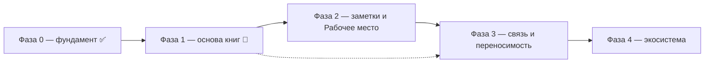

# ROADMAP — Текстура

Стратегический план продукта. Это **источник истины по направлению и
приоритетам**, а не описание текущего состояния. Текущее состояние фиксируют
`openspec/specs/`, конкретные задачи — `openspec/changes/`.

## Как пользоваться

1. Перед планированием свериться с этим файлом: выбрать домен и этап.
2. Из пункта этапа создать OpenSpec-изменение (`openspec/changes/<change>/`
   с `proposal.md`, `design.md`, `tasks.md`).
3. После реализации и archive изменение обновляет `openspec/specs/`, а в этом
   файле отмечается прогресс этапа.
4. Смысловые развилки фиксировать в «Журнале решений» — чтобы не пересматривать
   их заново.

Статусы: ✅ закрыто · 🚧 есть, но требует доработки · ⏭️ дальше · 💤 позже ·
❓ не решено. На текущий момент **ни один этап не закрыт**.

## Видение

Профессиональный инструмент исследователя книг, который изучает текст.
В основе — два симметричных пространства:

- **Пространство книг** — библиотека: хранение, метаданные, поиск, подборки,
  источники.
- **Пространство заметок** — заметки: хранение, метаданные, поиск, группировка,
  истории, импорт/экспорт.

С каждым пространством работают одинаково (хранение + поиск + организация), но
они существуют отдельно. Точка их встречи — **Рабочее место** (reader + editor):
там книга и заметки сходятся вместе, и исследователь читает текст, ведёт и
использует заметки. Ради этой встречи строится всё остальное; каталог, поиск и
источники книг — обслуживающая инфраструктура.

Приложение поддерживает **несколько библиотек** одновременно: пользователь
открывает разные (свою, calibre, другие источники) и легко переключается.

## Принципы

- **Рабочее место — точка сборки.** Читалка и редактор заметок — одно место;
  заметки создаются и используются там, где читается книга.
- **Симметрия пространств.** Книги и заметки — равноправные коллекции со своим
  хранением, поиском и организацией.
- **Заметки хранятся отдельно от книги.** Привязаны к ней, но переносимы.
- **Источник не знает о совместимости.** Generic-источник сканирует директорию
  книг и анализирует их сам; совместимость с конкретным менеджером (calibre и
  др.) — отдельный явный плагин поверх общего.
- **Индекс в SQLite.** Локальный каталог — реляционная БД, пригодная для
  сложного поиска и фильтрации; JSON для этого бесперспективен.
- **Plugin-first.** Формат книги, способ чтения, привязка заметок, источники —
  в плагинах; ядро не знает о форматах, структурах и конкретных источниках.
- **Local-first и портируемость.** Библиотека и заметки переносимы, без облака.
- **Opaque-контракты ядра.** Ядро не интерпретирует модели плагинов, а
  маршрутизирует их.
- **Опциональность тяжёлого.** LLM, сетевые сервисы, внешние редакторы — плагины.

## Домены

| Слой | Домен | Capability | Статус |
| --- | --- | --- | --- |
| Фундамент | Plugin-system, shell, настройки, уведомления, файловый стор | `plugin-system`, `app-shell`, `settings`, `notifications`, `plugin-store` | ✅ |
| Фундамент | Декларативный UI плагинов: пространства, SDK, рендерер | `plugin-ui` | ⏭️ |
| Пространство книг | Generic источник «директория книг» (скан/анализ своих правил) | `books-source` | 🚧 переработка |
| Пространство книг | Calibre-совместимость (явный отдельный плагин) | `calibre-source` | ⏭️ |
| Пространство книг | Локальный каталог и индекс на SQLite | `library-index` | ✅ |
| Пространство книг | Несколько библиотек и переключение | `library-manager` | 🚧 |
| Пространство книг | Метаданные, подборки, поиск | `catalog`, `collections`, `search` | ⏭️ |
| Пространство заметок | Хранение заметок | `notes-store` | ❓ |
| Пространство заметок | Поиск, группировка, истории | `notes-search` | ⏭️ |
| Пространство заметок | Импорт/экспорт | `notes-io` | ⏭️ |
| Точка встречи | Рабочее место: reader + editor | `reader`, `editor` | ❓ |
| Точка встречи | Workspace чтения (сноски, содержание, вкладки) | `reading-workspace` | ⏭️ |
| Точка встречи | Идентификация книги → привязка заметок | `book-identity` | ❓ |
| Экосистема | Темы оформления | `themes` | 💤 |
| Экосистема | Сетевой стор плагинов (следующий шаг, с подписью пакетов) | `plugin-store` (расширение) | 💤 |
| Экосистема | LLM-поиск, новые форматы | `search` (расширение), `reader` (расширение) | 💤 |

## Незавершённое (техдолг, блокирует продвижение)

- Плагин `library` сканирует структуру «автор/книга» — это частный случай
  (calibre-раскладка). Нужен generic-источник, который анализирует книги сам,
  и отдельный явный `calibre-source` поверх.
- Нет модели нескольких библиотек и переключения между ними.
- Автономные frontend-плагины (`plugins/*`, iframe, `kind: "ui"`, отдельная сборка
  в `public/plugins/`) противоречат единой дизайн-системе: каждый плагин рисует
  свой интерфейс. Подлежат замене: UI первых плагинов переносится в приложение, а
  для сторонних плагинов вводится декларативный UI (`packages/ui-schema`) с
  рендером компонентами `@texture/ui`.
- `_docs/issues/calibre-as-source-plugin.md` устарел (calibre подан как основа, а
  не как один из источников) — пересмотреть.

## Этапы

### Фаза 0 — фундамент ✅

- Plugin-system, shell, базовые плагины (notifications, settings) — есть.
- Файловый стор плагинов: базовый плагин `plugin-store` устанавливает и удаляет
  zip-пакеты в пользовательский каталог, ведёт реестр сторов и заглушку сетевого
  провайдера; UI — `plugin-store-ui`.
- Сетевой стор и **подпись/проверка пакетов** — следующий шаг Фазы 4.

**Выход:** каркас приложения, базовые плагины и установка плагинов из файла.

### Фаза 1 — надёжная основа пространства книг 🚧

- `books-source`: generic-источник — сканирует произвольную директорию книг и
  сам анализирует структуру и файлы, строит каталог. Не знает о calibre.
- `calibre-source`: отдельный, явно названный плагин совместимости — работает
  строго с calibre (её раскладка и метаданные). Подключается по желанию:
  пользователь ставит плагин, выбирает библиотеку, пользуется.
- `library-index`: локальный каталог/индекс на SQLite (сложный поиск и
  фильтрация), вместо JSON.
- `library-manager`: несколько библиотек в одном приложении и быстрое
  переключение между ними.

**Выход:** можно открыть несколько библиотек разных типов, переключаться,
искать и фильтровать по реляционному индексу.

### Фаза 2 — пространство заметок и Рабочее место (ядро ценности)

- `notes-store`: модель и хранение заметок отдельно от книги.
- `reader`: первый плагин-просмотрщик (EPUB).
- `editor`: ведение заметок в Рабочем месте, привязка к месту в книге.
- `reading-workspace`: панели/вкладки рядом с текстом — сноски, содержание,
  переключение без потери позиции.

**Выход:** можно открыть книгу, читать и тут же вести заметки.

### Фаза 3 — связь и переносимость

- `book-identity`: устойчивый идентификатор книги по косвенным признакам
  (хеши содержимого, метаданные, fuzzy) → заметки не теряются при смене файла
  или издания.
- `notes-io`: импорт/экспорт, «истории» заметок одной книги.
- `notes-search`: поиск и группировка заметок.
- `catalog`, `collections`, `search`: метаданные, теги/подборки, единый поиск.

**Выход:** заметки привязаны к произведению, переносимы, находятся; библиотека
пригодна как каталог.

### Фаза 4 — экосистема

- `reader`: новые форматы (PDF, MOBI и др.).
- `themes`: темы оформления интерфейса и Рабочего места.
- `plugin-store`: сетевой стор плагинов. Перед включением сети — **подпись
  пакетов и проверка целостности/доверия** издателю.
- `search` + LLM: семантический индекс (опциональный плагин).

## Не-цели

- Повторять или копировать Calibre; совместимость с ней — опциональный плагин.
- Облачная синхронизация и аккаунты.
- Обязательная интернет-зависимость для базовых функций.
- Собственный формат книги — работаем с существующими форматами.
- Монетизация/магазин плагинов на текущем горизонте.

## Открытые вопросы

- ❓ **Кто владеет SQLite-индексом.** Ядро предоставляет БД, а плагин только
  отдаёт данные, или плагин получает SQLite host API. Текущие спеки говорят
  «индексом владеет плагин» — конфликтует со SQLite-хранилищем.
- ❓ **Модель мультибиблиотечности.** Реестр библиотек, переключение; как к этому
  привязаны заметки — общие для всех библиотек или у каждой свои.
- ❓ **Граница reader ↔ editor ↔ notes-store.** Что в reader-плагине, что в
  редакторе, а что в общем хранилище заметок.
- ❓ **Формат заметок.** Отдельный файл рядом с книгой vs хранилище библиотеки vs
  экспорт в Markdown/Obsidian-совместимое.
- ❓ **Идентификация книги.** Основной ключ и разрешение коллизий.
- ❓ **Модель вкладок workspace.** Панели внутри одной книги vs вкладки-
  документы общего пространства.
- ❓ **LLM-стек.** Локальная модель vs внешний провайдер, где живёт индекс.

## Журнал решений

| Дата | Решение | Обоснование |
| --- | --- | --- |
| 2026-09-25 | Стратегию хранить в `ROADMAP.md`, а не в AGENTS.md | AGENTS.md — стабильные правила; план версионируется и меняется отдельно |
| 2026-09-25 | Соответствие «домен → capability-спека» в OpenSpec | Этапы плана естественно ложатся на proposals/specs |
| 2026-09-25 | Заметки — не отдельная фича, а главная функция Рабочего места | Ради чтения с заметками затевался проект |
| 2026-09-25 | Модель двух симметричных пространств (книги и заметки) + точка встречи | К заметкам применимо всё то же, что к книгам |
| 2026-09-25 | Точка сборки называется «Рабочее место» | Описательно и однозначно: читалка и редактор — одно место |
| 2026-09-25 | Calibre — не основа, а один из источников; generic-источник отдельно | Calibre взята лишь для примера; источник должен анализировать книги сам |
| 2026-09-25 | Локальный индекс — SQLite, а не JSON | Дальше нужен сложный поиск и фильтрация |
| 2026-09-25 | Поддержка нескольких библиотек с переключением | У пользователя может быть своя, calibre и другие библиотеки одновременно |
| 2026-09-25 | Файловый стор плагинов входит в фундамент | Базовый набор не закрыт без установки плагинов |
| 2026-09-25 | Файловый стор реализован; Фаза 0 закрыта | Установка/удаление zip-пакетов и UI стора готовы |
| 2026-09-25 | Подпись пакетов — обязательный шаг перед сетевым стором | Сейчас пакет не проверяется на авторство; зафиксировано на будущее |
| 2026-09-26 | Приложение переименовано в «Текстура»; bundle identifier — `ru.jarogor.texture` | Полный ребрендинг: единое отображаемое имя, латинские технические имена, смена каталога данных без автопереноса |
| 2026-09-26 | Отказываемся от автономных frontend-плагинов (iframe, `kind: "ui"`, отдельные сборки) | Единая дизайн-система несовместима с тем, что каждый плагин рисует свой интерфейс: теряется единство и контроль оформления |
| 2026-09-26 | UI плагинов — декларативное дерево по `ui-schema`; рендерит хост компонентами `@texture/ui` | Контроль дизайна остаётся у ядра: плагин описывает, что показать, хост решает как; легко менять и совершенствовать интерфейс независимо от плагинов |
| 2026-09-26 | Взаимодействие UI ↔ плагин — интенты (`on`: событие → идентификатор действия), без колбеков | Колбеки дают реентерантность и проблемы конкурентности; вместо них — унидирекциональный поток: хост сериализует вызовы, плагин возвращает новую декларацию/состояние |
| 2026-09-26 | UI-точки расширения — пространства со стабильными идентификаторами; плагин добавляет только явно разрешённые элементы | Плагины в перспективе пишут сторонние авторы; свободу ограничиваем и разрешаем явно |
| 2026-09-26 | Нужен SDK для UI-плагинов с версионированием (`ui-schema` + контракт) | Через версии обеспечиваем согласованность интерфейса и совместимость при развитии |
| 2026-09-26 | Декларативный UI и SDK отложены до появления моделей библиотеки и рабочего места | Преждевременно: пространства UI нельзя спроектировать до их доменов; сначала точечные улучшения системного интерфейса |
| 2026-09-27 | SQLite-индекс source-плагинов через generic SQL host API ядра (`sql_execute`/`sql_query`); схема и запросы — у плагина | Ядро не интерпретирует модель (plugin-first, opaque); обход ограничений WASM без WASI FS |
| 2026-09-27 | Файл SQLite-базы вне директории библиотеки, ключ — провайдер + канонический корень | Сохраняет read-only внешнего источника и устраняет общий ключ JSON-состояния, перезаписывавший данные между библиотеками |
| 2026-09-27 | Взят `library-index` (SQLite); создано изменение `library-sqlite-index`; `declarative-plugin-ui` остаётся отложенным | Приоритет техдолга Фазы 1 над декларативным UI |
| 2026-09-27 | `library-index` реализован: generic SQL host API, `fs_list_dir` с `size`/`mtime`, плагины `library` и `library-calibre` на SQLite с инкрементальной актуализацией | Повторное открытие не перечитывает неизменённые книги; устранён общий JSON-ключ, перезаписывавший состояние между библиотеками |
| 2026-09-27 | «Индекс» — единый полный набор знаний о книге (метаданные и обложка), а не набор подсистем; форма хранения — деталь | Пользователь: индекс — бизнес-понятие; дробление на «обложки/индексирование» неверно |
| 2026-09-27 | Схема индекса — версионированными миграциями (`PRAGMA user_version`), а не `CREATE TABLE IF NOT EXISTS` | Свойства книг будут расширяться; добавление полей не должно требовать перестройки |
| 2026-09-27 | Индекс строится одним измеряемым проходом с прогрессом в процентах; фоновое дозаполнение библиотеки отклонено | Пользователь хочет понимать время ожидания; динамическое наполнение дезориентирует |
| 2026-09-27 | `library-sqlite-index` заархивировано; создано изменение `library-index-build` (миграции, обложка в индексе, прогресс) | Продолжение линии индекса; спеки синхронизированы |
| 2026-09-27 | `library-index-build` реализован: crate `index-migrations`, обложка в индексе, событие прогресса `library-index-progress`, прогресс-бар в UI | Индекс стал полным (метаданные+обложка) и расширяемым; открытие показывает проценты |
| 2026-09-27 | `probe` Calibre упрощён до проверки `metadata.db`; прогресс `{done:0,total}` публикуется сразу после определения объёма | Убрано «подвисание» до прогресс-бара: полный обход в `probe` и задержка на первой книге |
| 2026-09-27 | Тесты ядра запускаются последовательно (`.cargo/config.toml`, `RUST_TEST_THREADS=1`) | Глобальная шина событий и уровень логирования делали параллельные тесты флейки |
| 2026-09-28 | `library-index-build` заархивировано после реализации и проверок; спеки синхронизированы | Индекс: полный (метаданные+обложка), миграции, прогресс |
| 2026-09-28 | Пункт о паузе до прогресса: причина — первичная JIT-компиляция source-WASM (~3.4 c, кэшируется wasmtime); отдельная задача — предкомпиляция в `.cwasm` на сборке | Обход библиотеки (28 мс) и кэшированная загрузка (~80 мс) ни при чём |
