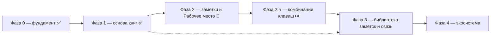

# ROADMAP — Текстура

Стратегический план продукта. Это **источник истины по направлению и
приоритетам**, а не описание текущего состояния. Текущее состояние фиксируют
`openspec/specs/`, конкретные задачи — `openspec/changes/`.

## Как пользоваться

1. Перед планированием свериться с этим файлом: выбрать домен и этап.
2. Из пункта этапа создать OpenSpec-изменение (`openspec/changes/<change>/`
   с `proposal.md`, `design.md`, `tasks.md`).
3. После реализации и archive изменение обновляет `openspec/specs/`, а в этом
   файле отмечается прогресс этапа.
4. Смысловые развилки фиксировать в «Журнале решений» — чтобы не пересматривать
   их заново.

Статусы: ✅ закрыто · 🚧 есть, но требует доработки · ⏭️ дальше · 💤 позже ·
❓ не решено. Закрыты Фазы 0 и 1; остальные — в работе или впереди.

## Видение

**Текстура — инструмент исследователя книг.** Читать можно по-разному: роман
читается линейно, от начала к концу, а справочник, инструкцию, научную или
философскую работу так читать нельзя — их читают медленно, в разном направлении,
с разных мест, с возвратами и сопоставлениями. Такое чтение неотделимо от
заметок. Инструмент существует, чтобы вести исследование текста: держать книги,
вести заметки и сводить их в одном рабочем месте.

Инструмент состоит из каркаса и четырёх содержательных частей.

1. **Каркас** — приложение, расширяемое плагинами: базовыми (уведомления,
   настройки, стор, единый интерфейс) и внешними, пользовательскими; в
   перспективе — SDK для сторонних авторов.
2. **Библиотека книг** — пространство книг. Открывает набор книг, умеет искать,
   фильтровать и делать подборки, открывать разные подборки в разных вкладках, в
   перспективе — LLM-поиск. Имеет **страницу книги** с информацией о книге и
   возможностью её редактировать: название, авторы, год, теги и прочие поля.
3. **Рабочее место** — точка сборки книги и заметок: **браузер с вкладками**, где
   открываются разные книги и разные варианты их просмотра. Вкладка — открытая
   книга со своей позицией, масштабом и режимом чтения; заметки ведутся в том же
   месте. **Заметка привязана к книге, а не к вкладке**: одну книгу можно открыть
   в разных рабочих местах и получить одни и те же, пополняемые отовсюду заметки;
   разные части одной книги сравниваются соседними вкладками. Рабочих мест много:
   это именованные сохраняемые композиции, их список — точка входа приложения.
   Рабочее место **ссылается** на книги и заметки, но не хранит их. Для каждого
   формата чтение обеспечивает плагин рабочего места с **унифицированным
   функционалом**.
4. **Библиотека заметок** — пространство заметок: отдельный реестр **наборов
   заметок** к разным книгам со своим поиском и вкладками-подборками. Позволяет
   делиться наборами: принять чужой набор к книге, импортировать его себе и иметь
   одновременно свои и чужие — искать, отображать и организовывать их.

**Точка сборки — Рабочее место.** С одной стороны к нему приходят книги, с
другой — заметки (свои и чужие наборы), и в нём исследователь получает всё
нужное. Ради этой встречи строится всё остальное; каталог, поиск и источники книг
— обслуживающая инфраструктура. Библиотеки книг и заметок — **хранилища**;
рабочее место — **сохранённая композиция** поверх них: оно ссылается на книги и
заметки, но не владеет ими. Главный экран приложения — список рабочих мест.
С книгами и заметками работают одинаково (хранение + поиск + организация), но
пространства существуют отдельно.

Приложение поддерживает **несколько библиотек** одновременно: пользователь
открывает разные (свою, calibre, другие источники) и легко переключается.

## Термины

- **Книга** — единица пространства книг: конкретное произведение в конкретном
  файле или издании.
- **Страница книги** — экран информации о книге и действий с ней; здесь
  редактируются метаданные (название, авторы, год, теги и др.).
- **Подборка** — именованное подмножество книг или наборов заметок, собранное по
  правилу или вручную.
- **Рабочее место** — именованная сохраняемая композиция для исследования: список
  вкладок и ведение заметок. Ссылается на книги и заметки, не владея ими.
- **Вкладка** — открытая в рабочем месте книга со своей позицией, масштабом и
  режимом чтения. Разные части одной книги — соседние вкладки одной книги.
- **Вложение** — то, на что указывает вкладка: книга из библиотеки или
  произвольный файл.
- **Заметка** — запись исследователя, привязанная к месту в книге.
- **Набор заметок** — именованная совокупность заметок к **одной книге**;
  основная единица организации, переключения, поиска и обмена.
- **Библиотека заметок** — отдельный реестр всех наборов заметок по всем книгам;
  поиск, подборки, обмен.
- **Каркас** — приложение-оболочка и базовые сервисы, не зависящие от книги.
- **Плагин рабочего места** — плагин, дающий чтение и заметки для конкретного
  формата книги с унифицированным функционалом.

## Принципы

- **Нелинейное чтение — главный сценарий.** Инструмент рассчитан на чтение с
  разных мест и в разном направлении, а не только на последовательное прочтение.
- **Рабочее место — точка сборки.** Читалка и редактор заметок — одно место;
  заметки создаются и используются там, где читается книга.
- **Рабочее место — браузер вкладок и композиция.** Вкладки открывают разные
  книги и разные варианты просмотра; рабочее место ссылается на книги и заметки,
  а не хранит их; рабочих мест много, и их список — точка входа приложения.
- **Заметки привязаны к книге, а не к вкладке.** Одну книгу можно вести из разных
  рабочих мест и видеть общее, пополняемое отовсюду состояние заметок.
- **Заметки организованы наборами.** Единица заметок — набор к книге; наборы
  переключаются, ищутся и переносятся, свои и чужие сосуществуют.
- **Симметрия пространств.** Книги и заметки — равноправные коллекции со своим
  хранением, поиском и организацией.
- **Заметки хранятся отдельно от книги.** Привязаны к ней, но переносимы.
- **Рабочее место — плагин на формат.** Единый функционал чтения и заметок
  реализуется отдельно для каждого формата. Плагин рабочего места **рисует только
  область содержимого**; управление и оформление страницы — у приложения.
- **Единая дизайн-система неприкосновенна.** Оформление и управление контролирует
  приложение: единообразие и предсказуемость важнее свободы плагинов, потому что
  приложение существует ради удобства, а богатое и неудобное никому не нужно.
  Отсюда — отказ от фронтенда в обычных плагинах и узкое исключение только для
  рисования содержимого.
- **Источник не знает о совместимости.** Generic-источник сканирует директорию
  книг и анализирует их сам; совместимость с конкретным менеджером (calibre и
  др.) — отдельный явный плагин поверх общего.
- **Индекс в SQLite.** Локальный каталог — реляционная БД, пригодная для
  сложного поиска и фильтрации; JSON для этого бесперспективен.
- **Plugin-first.** Формат книги, способ чтения, привязка заметок, источники —
  в плагинах; ядро не знает о форматах, структурах и конкретных источниках.
- **Local-first и портируемость.** Библиотека и заметки переносимы, без облака.
- **Opaque-контракты ядра.** Ядро не интерпретирует модели плагинов, а
  маршрутизирует их.
- **Опциональность тяжёлого.** LLM, сетевые сервисы, внешние редакторы — плагины.

## Домены

| Слой | Домен | Возможности | Статус |
| --- | --- | --- | --- |
| Фундамент | Plugin-system, shell, настройки, уведомления, файловый стор | `plugin-system`, `app-shell`, `settings`, `notifications`, `plugin-store` | ✅ |
| Фундамент | Декларативный UI плагинов и SDK: пространства, рендерер, контракт | `plugin-ui`, `plugin-sdk` | ✅ |
| Фундамент | Информация о приложении: версия и расположение служебных конфигов и кешей | `app-info` | ✅ |
| Фундамент | Служебные файлы состояния: реестр и форматы (JSON/TOML) | `app-state` | ✅ |
| Фундамент | Спецификации служебных конфигов и кешей (`plugin-manifest.json` и др.): техническая проверка корректности | `config-schemas` | ⏭️ |
| Пространство книг | Generic источник «директория книг» (скан/анализ своих правил) | `books-source` | ✅ |
| Пространство книг | Calibre-совместимость (явный отдельный плагин) | `calibre-source` | ✅ |
| Пространство книг | Локальный каталог и индекс на SQLite | `library-index` | ✅ |
| Пространство книг | Несколько библиотек и переключение | `library-manager` | ✅ |
| Пространство книг | Страница книги и редактирование метаданных (название, авторы, год, теги) | `book-page` | 🚧 показ есть, редактирования нет |
| Пространство книг | Подборки и поиск | `collections`, `search` | 🚧 поиск есть, подборок нет |
| Пространство книг | Вкладки: разные подборки/списки книг в отдельных вкладках | `library-tabs` | 💤 |
| Пространство книг | Открытие книги в рабочее место: передача абсолютного пути и поддержка форматов | `library-ui` | ✅ |
| Пространство заметок | Наборы заметок: модель и хранение, привязка к книге | `notes-store` | ✅ |
| Пространство заметок | Библиотека заметок: реестр наборов, поиск, подборки/вкладки | `notes-library` | ✅ реестр + поиск (подборки/вкладки — дальше) |
| Пространство заметок | Импорт/экспорт и обмен наборами | `notes-io` | ⏭️ |
| Пространство заметок | Блокнот рабочего места: общий на всё место, со ссылками на заметки книг | `workspace-notebook` | 💤 понижен в приоритете |
| Точка встречи | Рабочее место: чтение книги (reader) | `reader` | ✅ |
| Точка встречи | Редактор заметок: заметки-цитаты выделением на странице, точное восстановление, подсветка, список | `editor` | ✅ |
| Точка встречи | Рабочее место — реестр рабочих мест: хранение, недоступные книги, переносимость | `workspace-manager` | 🚧 нет переносимости |
| Точка встречи | Браузер вкладок: разные книги и варианты просмотра, позиции, масштаб, панель открытых книг | `reading-workspace` | ✅ |
| Точка встречи | Плагины рабочего места: форматы, где содержимое рисует плагин (управление — приложение) | `reader-plugins` | 🚧 |
| Точка встречи | Система комбинаций клавиш: реестр действий и привязок, внедрение по всему функционалу | `hotkeys` | ⏭️ |
| Точка встречи | Идентификация книги → привязка заметок | `book-identity` | ❓ |
| Экосистема | Темы оформления (тема светлая/тёмная/системная, палитры Gruvbox/Mist и переключатель в шапке — закрыта база `app-theme`; **тема области чтения** — независимая сторона палитры, закрыта `reader-theme`; внешние палитры — впереди) | `themes` | 🚧 |
| Экосистема | Проверка новых версий и автообновление приложения (начать с файлового источника) | `app-update` | ⏭️ |
| Экосистема | Сетевой стор плагинов (следующий шаг, с подписью пакетов) | `plugin-store` (расширение) | 💤 |
| Экосистема | LLM-поиск, новые форматы | `search` (расширение), `reader` (расширение) | 💤 |

## Незавершённое (техдолг, блокирует продвижение)

- Модель **набора заметок** и хранилище есть, реестр заметок с глобальным поиском
  реализован (`notes-library`, реестр + поиск). Остаются подборки/вкладки заметок
  и обмен наборами (`notes-io`) — следующими шагами. Без них Рабочее место
  неполно.
- Чтение рабочего места **не зависит от открытой библиотеки**: вложение вкладки —
  путь к файлу, чтение идёт отдельным runtime ядра. Прежний техдолг «связь
  рабочего места с библиотекой» закрыт по части вложения; остаётся переносимость
  рабочих мест (экспорт/импорт).
- Механизм **плагина рабочего места** введён (`workplace-content-plugins`) и
  проверен первым рисующим форматом PDF (`reader-pdf`: плагин `workplace-pdf`).
  Остаётся: установка сторонних плагинов рабочего места из стора и общий модуль
  рисования, а также новые форматы (Фаза 4).
- Страница книги только показывает информацию: нет редактирования метаданных
  (название, авторы, год, теги) и нет подборок книг. Поиск по индексу уже есть.
- Декларативный UI для **сторонних** плагинов (`packages/ui-schema`) с рендером
  компонентами `@texture/ui` реализован: первое пространство `settings.section`,
  плагин отдаёт дерево `ui-schema`, оболочка рендерит его обобщённым рендерером и
  присылает интенты; SDK — `src-wasm-plugins/ui-sdk`. Расширение каталога
  пространств и компонентов — отдельный последующий шаг. Исключение — плагины
  рабочего места, рисующие **только** область содержимого книги.
- `_docs/issues/calibre-as-source-plugin.md` устарел (описывает calibre как основу
  переноса из ядра; фактически есть generic-источник `library` и отдельный
  `library-calibre`). Файл следует переработать или удалить.

## Этапы

### Фаза 0 — фундамент ✅

- Plugin-system, shell, базовые плагины (notifications, settings) — есть.
- Файловый стор плагинов: базовый плагин `plugin-store` устанавливает и удаляет
  zip-пакеты в пользовательский каталог, ведёт реестр сторов и заглушку сетевого
  провайдера; UI стора — встроенная поверхность оболочки `StorePage.svelte`.
- Сетевой стор и **подпись/проверка пакетов** — следующий шаг Фазы 4.

**Выход:** каркас приложения, базовые плагины и установка плагинов из файла.

### Фаза 1 — надёжная основа пространства книг (остался `config-schemas`)

- `books-source`: generic-источник `library` — сканирует произвольную директорию
  книг и сам анализирует структуру и файлы, строит каталог. Не знает о calibre. ✅
- `calibre-source`: отдельный плагин `library-calibre` — подтверждает только
  директории с `metadata.db`, раскладка «<автор>/<книга>». ✅
- `library-index`: локальный каталог/индекс на SQLite (сложный поиск и
  фильтрация). ✅
- `library-manager`: несколько библиотек в одном приложении и быстрое
  переключение между ними (реестр `library-history`, `select_source_library`,
  страница «Библиотеки»). ✅
- `app-info`: страница «Информация» в настройках — версия приложения и
  расположение служебных конфигов и кешей. ✅
- `config-schemas`: спецификации всех служебных конфигов и кешей (в том числе
  `plugin-manifest.json`) — чтобы технически проверять их корректность и явно
  описывать, на что рассчитывать разработчику (поля, обязательность, значения по
  умолчанию, версия контракта). Часть работы уже сделана изменением
  `app-state-files` (реестр и форматы файлов состояния, спека `app-state`);
  остаётся машинно-проверяемая форма (схемы и валидация) для конфигов плагинов и
  приложения. ⏭️

**Выход:** можно открыть несколько библиотек разных типов, переключаться,
искать и фильтровать по реляционному индексу. — **достигнут**.

### Фаза 2 — пространство заметок и Рабочее место (ядро ценности) 🚧

Закрыта, кроме **блокнота рабочего места** (понижен в приоритете, см. ниже).
`reader`, `editor`, `reading-workspace`, `notes-store`, `notes-library` (реестр +
поиск) — ✅; `workspace-manager` — без переносимости; `reader-plugins` — механизм
есть, установка сторонних плагинов и общий модуль рисования впереди.

- `notes-store`: модель и хранение **наборов заметок** отдельно от книги; заметка
  привязана к месту в книге, набор — к книге. ✅
- `notes-library`: реестр наборов заметок по всем книгам, группировка по книге,
  глобальный поиск, переход к книге/заметке. ✅ (реестр + поиск; подборки/вкладки
  и обмен наборами — `notes-io`)
- `reader-plugins`: механизм плагина рабочего места — плагин объявляет форматы и
  рисует **только область содержимого**, управление рисует приложение; приложение
  выбирает плагин по формату, ядро форматов не знает. ✅ (механизм)
- `reader`: рабочая страница чтения EPUB (через source-плагин) и подключение
  плагинов рабочего места для рисующих форматов. ✅
- `editor`: ведение заметок в Рабочем месте — создание и правка, привязка к месту,
  **переключение наборов**, поиск внутри набора. ✅
- `workspace-manager`: реестр рабочих мест — создание, открытие, переименование и
  сохранение; недоступные книги с переуказанием пути и сохранением настроек
  вкладки; переносимость (экспорт/импорт) позже; хранение в служебном каталоге
  приложения. 🚧 (без переносимости)
- `reading-workspace`: браузер вкладок — разные книги и разные варианты просмотра
  одной книги, режимы чтения (прокрутка/страницы), масштаб, сохранение позиции,
  панель списка открытых книг. Главный экран — список рабочих мест. ✅
- `workspace-notebook` (замысел): **блокнот рабочего места** — заметки, не
  привязанные ни к одной книге, общие на всё рабочее место. Наборы заметок
  принадлежат книге; блокнот — это место для мыслей «между книгами»: плана
  чтения, черновиков, выводов по нескольким источникам. Блокнот может
  **ссылаться на заметки и книги** рабочего места, но сами заметки книг не
  заменяет. Владение блокнотом — рабочее место (а не книга), поэтому он
  переживает закрытие книг и виден из любой вкладки. 💤 (понижен в приоритете:
  делается позже, не блокирует библиотеку заметок).

**Выход:** можно держать несколько рабочих мест, открывать в них множество книг
вкладками, читать и вести общие для книги заметки в разных наборах, не теряя
состояние открытия.

### Фаза 2.5 — система комбинаций клавиш ⏭️

- `hotkeys`: реестр действий и привязок комбинаций клавиш с единым внедрением по
  всему функционалу (чтение, навигация по страницам и позиции, заметки, панели,
  масштаб). Требует отдельного проектирования: перечень действий, набор сочетаний,
  настраиваемость и защита от конфликтов с вводом текста. Делается **после**
  стабилизации тех функций, которым назначаются сочетания, чтобы не проектировать
  привязки к меняющемуся поведению.

### Фаза 3 — связь, библиотека заметок и переносимость

- `book-identity`: устойчивый идентификатор книги по косвенным признакам
  (хеши содержимого, метаданные, fuzzy) → заметки не теряются при смене файла
  или издания.
- `notes-library` (подборки/вкладки) и `notes-io`: объединение наборов в подборки,
  импорт/экспорт и обмен наборами — свои и чужие сосуществуют.
- `book-page`, `catalog`, `collections`, `search`: редактирование метаданных,
  теги/подборки, вкладки подборок книг, единый поиск.

**Выход:** заметки привязаны к произведению, переносимы, находятся и передаются;
библиотека пригодна как каталог.

### Фаза 4 — экосистема

- `reader-plugins`: рабочие места для новых форматов (MOBI, EPUB-фикс и др.) с
  единым функционалом; PDF уже поддержан (`workplace-pdf`).
- `themes`: темы оформления интерфейса и Рабочего места.
- `app-update`: проверка новых версий приложения и автообновление. Начать с
  **файлового источника** (каталог/манифест версии рядом с поставкой), затем —
  сетевой источник; перед сетевым включить проверку подписи и целостности.
- `plugin-store`: сетевой стор плагинов. Перед включением сети — **подпись
  пакетов и проверка целостности/доверия** издателю.
- `search` + LLM: семантический индекс (опциональный плагин).
- `plugin-ui` + `plugin-sdk`: декларативный UI и SDK для сторонних авторов.

## Не-цели

- Повторять или копировать Calibre; совместимость с ней — опциональный плагин.
- Облачная синхронизация и аккаунты.
- Обязательная интернет-зависимость для базовых функций.
- Собственный формат книги — работаем с существующими форматами.
- Монетизация/магазин плагинов на текущем горизонте.

## Открытые вопросы

- ❓ **Кто владеет SQLite-индексом.** Ядро предоставляет БД, а плагин только
  отдаёт данные, или плагин получает SQLite host API. Текущие спеки говорят
  «индексом владеет плагин» — конфликтует со SQLite-хранилищем.
- ❓ **Модель мультибиблиотечности.** Реестр библиотек, переключение; как к этому
  привязаны заметки — общие для всех библиотек или у каждой свои.
- ❓ **Граница reader ↔ editor ↔ notes-store.** Что в плагине чтения, что в
  редакторе заметок, а что в общем хранилище наборов.
- ❓ **Идентичность набора заметок и обмен.** Как набор адресуется для передачи
  (идентификатор, автор, версия), как отличать свой набор от чужого.
- ❓ **Формат набора заметок.** Отдельный файл рядом с книгой vs хранилище
  библиотеки vs экспорт в Markdown/Obsidian-совместимое.
- ❓ **Идентификация книги.** Основной ключ и разрешение коллизий; к чему
  привязывается набор — к произведению или к конкретному файлу/изданию.
- ❓ **Хранение и связь рабочего места с библиотеками.** Реестр рабочих мест живёт
  в служебном каталоге приложения; вкладка адресует книгу **путём к файлу** и не
  зависит от открытой библиотеки. Открыт вопрос переносимости рабочих мест
  (экспорт/импорт) и поведения при переезде файлов.
- ❓ **Связь «библиотека ↔ рабочее место» (многие ко многим).** В рабочем месте
  выбирают книги (библиотека или произвольный путь), в библиотеке выбирают
  рабочее место для открытия книги. Плагин-связка vs мини-поиск источников на
  обеих сторонах; путь-вложение уже снимает необходимость открытой библиотеки.
- ❓ **Выбор набора заметок.** На книгу (общий для всех её вкладок) или на вкладку
  — решено: **на книгу** через ключ `bookKey(path)`; открыт вопрос смены ключа на
  стабильную идентификацию (`book-identity`).
- ❓ **Модель вкладок Библиотеки.** Как устроены вкладки подборок и сохраняются ли
  они между запусками.
- ❓ **Оформление списка книг (книги — отдельная забота).** Список книг библиотеки
  богат (обложка, название, авторы, действия) и пока оставлен как есть. Нужны **два
  привычных режима показа — «список» и «плитка»**, как это обычно делают; делать
  это следует отдельным изменением, не трогая остальные страницы-списки. Памятка
  внесена при унификации страниц-списков (изменение `unified-list-pages`).
- ❓ **Интернационализация интерфейса (i18n).** Сейчас весь текст русский, даты
  намеренно форматируются по-русски (`ДД.ММ.ГГГГ чч:мм`), а не по локали
  окружения. Нужен выбор языка интерфейса и следование ему в текстах и формате
  дат; до этого даты остаются русскими. Связано с оформлением единого пункта
  списка (`unified-list-pages`).
- ❓ **LLM-стек.** Локальная модель vs внешний провайдер, где живёт индекс.

## Журнал решений

| Дата | Решение | Обоснование |
| --- | --- | --- |
| 2026-09-25 | Стратегию хранить в `ROADMAP.md`, а не в AGENTS.md | AGENTS.md — стабильные правила; план версионируется и меняется отдельно |
| 2026-09-25 | Соответствие «домен → спека-возможность» в OpenSpec | Этапы плана естественно ложатся на proposals/specs |
| 2026-09-25 | Заметки — не отдельная фича, а главная функция Рабочего места | Ради чтения с заметками затевался проект |
| 2026-09-25 | Модель двух симметричных пространств (книги и заметки) + точка встречи | К заметкам применимо всё то же, что к книгам |
| 2026-09-25 | Точка сборки называется «Рабочее место» | Описательно и однозначно: читалка и редактор — одно место |
| 2026-09-25 | Calibre — не основа, а один из источников; generic-источник отдельно | Calibre взята лишь для примера; источник должен анализировать книги сам |
| 2026-09-25 | Локальный индекс — SQLite, а не JSON | Дальше нужен сложный поиск и фильтрация |
| 2026-09-25 | Поддержка нескольких библиотек с переключением | У пользователя может быть своя, calibre и другие библиотеки одновременно |
| 2026-09-25 | Файловый стор плагинов входит в фундамент | Базовый набор не закрыт без установки плагинов |
| 2026-09-25 | Файловый стор реализован; Фаза 0 закрыта | Установка/удаление zip-пакетов и UI стора готовы |
| 2026-09-25 | Подпись пакетов — обязательный шаг перед сетевым стором | Сейчас пакет не проверяется на авторство; зафиксировано на будущее |
| 2026-09-26 | Приложение переименовано в «Текстура»; bundle identifier — `ru.jarogor.texture` | Полный ребрендинг: единое отображаемое имя, латинские технические имена, смена каталога данных без автопереноса |
| 2026-09-26 | Отказываемся от автономных frontend-плагинов (iframe, `kind: "ui"`, отдельные сборки) | Единая дизайн-система несовместима с тем, что каждый плагин рисует свой интерфейс: теряется единство и контроль оформления |
| 2026-09-26 | UI плагинов — декларативное дерево по `ui-schema`; рендерит хост компонентами `@texture/ui` | Контроль дизайна остаётся у ядра: плагин описывает, что показать, хост решает как; легко менять и совершенствовать интерфейс независимо от плагинов |
| 2026-09-26 | Взаимодействие UI ↔ плагин — интенты (`on`: событие → идентификатор действия), без колбеков | Колбеки дают реентерантность и проблемы конкурентности; вместо них — унидирекциональный поток: хост сериализует вызовы, плагин возвращает новую декларацию/состояние |
| 2026-09-26 | UI-точки расширения — пространства со стабильными идентификаторами; плагин добавляет только явно разрешённые элементы | Плагины в перспективе пишут сторонние авторы; свободу ограничиваем и разрешаем явно |
| 2026-09-26 | Нужен SDK для UI-плагинов с версионированием (`ui-schema` + контракт) | Через версии обеспечиваем согласованность интерфейса и совместимость при развитии |
| 2026-09-26 | Декларативный UI и SDK отложены до появления моделей библиотеки и рабочего места | Преждевременно: пространства UI нельзя спроектировать до их доменов; сначала точечные улучшения системного интерфейса |
| 2026-09-27 | SQLite-индекс source-плагинов через generic SQL host API ядра (`sql_execute`/`sql_query`); схема и запросы — у плагина | Ядро не интерпретирует модель (plugin-first, opaque); обход ограничений WASM без WASI FS |
| 2026-09-27 | Файл SQLite-базы вне директории библиотеки, ключ — провайдер + канонический корень | Сохраняет read-only внешнего источника и устраняет общий ключ JSON-состояния, перезаписывавший данные между библиотеками |
| 2026-09-27 | Взят `library-index` (SQLite); создано изменение `library-sqlite-index`; `declarative-plugin-ui` остаётся отложенным | Приоритет техдолга Фазы 1 над декларативным UI |
| 2026-09-27 | `library-index` реализован: generic SQL host API, `fs_list_dir` с `size`/`mtime`, плагины `library` и `library-calibre` на SQLite с инкрементальной актуализацией | Повторное открытие не перечитывает неизменённые книги; устранён общий JSON-ключ, перезаписывавший состояние между библиотеками |
| 2026-09-27 | «Индекс» — единый полный набор знаний о книге (метаданные и обложка), а не набор подсистем; форма хранения — деталь | Пользователь: индекс — бизнес-понятие; дробление на «обложки/индексирование» неверно |
| 2026-09-27 | Схема индекса — версионированными миграциями (`PRAGMA user_version`), а не `CREATE TABLE IF NOT EXISTS` | Свойства книг будут расширяться; добавление полей не должно требовать перестройки |
| 2026-09-27 | Индекс строится одним измеряемым проходом с прогрессом в процентах; фоновое дозаполнение библиотеки отклонено | Пользователь хочет понимать время ожидания; динамическое наполнение дезориентирует |
| 2026-09-27 | `library-sqlite-index` заархивировано; создано изменение `library-index-build` (миграции, обложка в индексе, прогресс) | Продолжение линии индекса; спеки синхронизированы |
| 2026-09-27 | `library-index-build` реализован: crate `index-migrations`, обложка в индексе, событие прогресса `library-index-progress`, прогресс-бар в UI | Индекс стал полным (метаданные+обложка) и расширяемым; открытие показывает проценты |
| 2026-09-27 | `probe` Calibre упрощён до проверки `metadata.db`; прогресс `{done:0,total}` публикуется сразу после определения объёма | Убрано «подвисание» до прогресс-бара: полный обход в `probe` и задержка на первой книге |
| 2026-09-27 | Тесты ядра запускаются последовательно (`.cargo/config.toml`, `RUST_TEST_THREADS=1`) | Глобальная шина событий и уровень логирования делали параллельные тесты флейки |
| 2026-09-28 | `library-index-build` заархивировано после реализации и проверок; спеки синхронизированы | Индекс: полный (метаданные+обложка), миграции, прогресс |
| 2026-09-28 | Пункт о паузе до прогресса: причина — первичная JIT-компиляция source-WASM (~3.4 c, кэшируется wasmtime); отдельная задача — предкомпиляция в `.cwasm` на сборке | Обход библиотеки (28 мс) и кэшированная загрузка (~80 мс) ни при чём |
| 2026-09-28 | Видение уточнено: инструмент **нелинейного** чтения (справочники, научные и философские труды), а не только последовательного | Это исходная мотивация проекта; без неё теряется смысл |
| 2026-09-28 | Инструмент описан как каркас + четыре части: библиотека книг, Рабочее место, библиотека заметок, служебное | Фиксирует полную картину, а не отдельные домены |
| 2026-09-28 | Введён термин **набор заметок** — совокупность заметок к одной книге; единица организации, переключения, поиска и обмена | Одинаковая терминология устраняет разночтения |
| 2026-09-28 | Введён домен **библиотека заметок** — отдельный реестр наборов по всем книгам с поиском, подборками и обменом | Заметки — не приложение к книге, а самостоятельное пространство |
| 2026-09-28 | Свои и чужие наборы заметок сосуществуют; набор можно передать и импортировать | Сценарий обмена заметками — часть ценности |
| 2026-09-28 | Рабочее место — **плагин на формат** с унифицированным функционалом (вкладки/окна одной книги, масштаб, режимы, заметки) | Форматов много; оболочка не должна знать о них |
| 2026-09-28 | Страница книги редактирует метаданные (название, авторы, год, теги) | Библиотека — не только просмотр, но и ведение каталога |
| 2026-09-28 | Вкладки библиотеки (разные подборки в отдельных вкладках) и вкладки Рабочего места (разные части одной книги) различаются как самостоятельные домены | Разные сущности и жизненные циклы |
| 2026-09-28 | SDK для сторонних авторов — в домене `plugin-sdk` (вместе с декларативным UI) | Единая точка для внешних разработчиков |
| 2026-09-28 | Причина отказа от фронтенда в плагинах зафиксирована целиком: фронтенд мешает единству интерфейса и контролю оформления, а это вопрос эргономики — богатое и неудобное приложение не нужно | Причина важнее самого правила; без неё правило пересматривается наугад |
| 2026-09-28 | Узкое **постоянное** исключение: плагины рабочего места рисуют **только область содержимого**, управление и оформление — у приложения | Сохраняет дизайн-систему и даёт форматам, требующим рисования, читаться плагином |
| 2026-09-28 | «Настоящий плагин читалки» невозможен без рисования; движок PDF в WASM отклонён как тяжёлый, выбран путь «приложение даёт изолированную область содержимого, плагин рисует» | Ядро не знает форматов, а рендер остаётся качественным |
| 2026-09-28 | Плагин PDF не решается декларативным UI (`declarative-plugin-ui`): тот про панели и элементы, а не про рисование страниц | Это разные механизмы; декларативный UI остаётся отдельной отложенной задачей |
| 2026-09-28 | Создано изменение `workplace-content-plugins`: тип плагина, модуль рисования в пакете, область содержимого и обмен, выбор по формату, доступность чтения по установленным плагинам | Механизм чтения форматов, требующих рисования |
| 2026-09-28 | Сам плагин PDF и выбор движка рендера — отдельный последующий шаг; границы изменения этим ограничены | Не смешивать механизм и первый формат |
| 2026-09-29 | **Рабочее место** — браузер вкладок разных книг и вариантов просмотра, а не страница одной книги; рабочая страница книги — лишь вкладка | Исходный замысел неоднократно терялся при фиксации; фиксируем окончательно |
| 2026-09-29 | Рабочее место — **композиция-ссылка** поверх хранилищ, а не третья библиотека; книги и заметки ему не принадлежат | Сохраняет симметрию двух пространств и не дублирует данные |
| 2026-09-29 | **Заметка привязана к книге, а не к вкладке**; одну книгу можно вести из разных рабочих мест и видеть общее состояние заметок | Сценарий сопоставительного чтения (Хайдеггер+Деррида, затем Хайдеггер+Карнап) |
| 2026-09-29 | Рабочих мест много; список рабочих мест — точка входа приложения | Смысл приложения — вести несколько исследований |
| 2026-09-29 | Рабочее место — **базовый (глобальный) плагин**, реестр в служебном каталоге приложения; позже переносимый (экспорт/импорт) | Не пользовательский плагин; общий для приложения, как настройки и уведомления |
| 2026-09-29 | Недоступная книга сохраняет настройки вкладки (позиция, масштаб); рабочее место даёт переуказать путь и переоткрыть | Состояние исследования не должно теряться |
| 2026-09-29 | Панель списка открытых книг в рабочем месте — по образцу панели уведомлений (скрыта, легко доступна) | Доступ к управлению вкладками, не мешая чтению |
| 2026-09-29 | Связь «библиотека ↔ рабочее место» — многие ко многим; способ соединения (плагин-связка или мини-поиск источников с обеих сторон) оставлен открытым | Пока не выбран; зафиксирован как открытый вопрос |
| 2026-09-30 | `notes-store` — **базовый плагин** наборов заметок (capability `notes.store@1`), а не модуль ядра; состояние — один JSON в служебном хранилище плагина | Принцип «plugin-first»: привязка заметок живёт в плагине, ядро только маршрутизирует opaque-операции |
| 2026-09-30 | Заметка привязана к книге **непрозрачным якорем** (строка плагина формата) плюс отображаемые метаданные; ключ книги тоже непрозрачен | Хранилище заметок не знает форматов; после `book-identity` источник ключа сменится без правки плагина |
| 2026-09-30 | Наборы заметок в этом срезе хранятся в JSON, а не в SQLite; поиск и реестр — домен `notes-library` | Личных заметок немного; SQLite остаётся возможным за тем же opaque-контрактом |
| 2026-09-30 | Панель заметок — **боковая область рабочего места** рядом с читалкой (по образцу панели открытых книг), а не отдельный раздел шапки | Заметки неотделимы от чтения; панель видна там, где читается книга |
| 2026-09-30 | Оболочка обращается к заметкам только opaque-операциями `notes.store@1`; модель хранилища ей неизвестна | Держит границу «ядро/оболочка ↔ плагин» и допускает смену хранилища (JSON → SQLite) |
| 2026-09-30 | Ключ книги пока формирует **оболочка** (библиотека + идентификатор книги); после `book-identity` источник ключа сменится без правки панели и плагина | Стабильной идентификации книги ещё нет; заметки уже общие для всех вкладок одной книги |
| 2026-09-30 | Образцы плагинов для разработчика помечаются признаком `sample` и показываются отдельной неброской группой в конце списка плагинов | Образцы не должны примешиваться к рабочим плагинам и создавать впечатление «демо-версии» |
| 2026-09-30 | Заметка — **цитата, выделенная в тексте книги**, а не запись у позиции прокрутки с набираемым текстом; содержание заметки и есть выделение | Работа «внутри книги» отличает инструмент от блокнота, ради неё он и создаётся |
| 2026-09-30 | Якорь заметки — **смещения символов внутри главы** (индексы узлов не нужны): не зависит от размера окна и масштаба, точно восстанавливает выделение | Требование пользователя: выделение восстанавливать «в точности как было» |
| 2026-09-30 | Место заметки — **номер страницы** для страничных форматов и доля позиции с десятичной точностью для форматов без страниц | Главная цель — PDF и страничная логика чтения; EPUB без страниц получает процент |
| 2026-09-30 | При запуске открывается **список рабочих мест**; конкретное рабочее место выбирает пользователь | Иначе список теряет смысл; активное место больше не восстанавливается молча |
| 2026-09-30 | Вложение вкладки — **путь к файлу книги**, а не идентификатор в каталоге библиотеки; рабочее место не знает, откуда книга | Требование пользователя; книга из библиотеки и файл с диска — единый случай |
| 2026-09-30 | Чтение книги — **отдельный runtime чтения** в ядре (source- и workplace-плагины), не зависящий от открытой библиотеки; песочница сужается до директории файла | Восстановленная вкладка падала с «plugin не выбран»; рабочее место должно читать книгу по пути |
| 2026-09-30 | Состояние «библиотека не открыта» и автоповтор библиотеки удалены полностью | Недопустимо навязывать библиотеку поперёк выбора пользователя; рабочее место независимо |
| 2026-09-30 | Недоступная вкладка переуказывается **любым файлом с диска** (системный диалог), а не только книгой библиотеки | Переуказание — выбор пользователя; штатные пути не должны ограничиваться каталогом |
| 2026-09-30 | Ключ заметок — **путь к файлу** (`bookKey(path)`), единый для всех вкладок книги в любых рабочих местах | Заметки принадлежат книге; после `book-identity` сменится источник ключа, хранилище заметок не меняется |
| 2026-10-01 | Заметка создаётся **контекстным меню** у выделения («Создать заметку»/«Отмена»), а не сразу при выделении; туда же добавятся цвет и текст | Пользователь подтверждает действие; готовим место для будущих полей |
| 2026-10-01 | При старте реестр рабочих мест грузится **до** отрисовки списка (индикатор загрузки), а не показывается пустой список | Ложное «рабочих мест нет» на секунду дезориентирует; состояние грузится сразу |
| 2026-10-01 | Читалка удерживает **живой диапазон второй видимой строки** при масштабе и смене ширины (панели) | Масштаб и открытие панелей не должны сбивать читаемое место; вторая строка — запас сверху |
| 2026-10-01 | Заметки в панели сортируются **по расположению в книге** (глава и смещение в якоре; без якоря — страница/доля), а не по времени добавления; дата остаётся для хронологии | Порядок списка должен отражать ход текста, а не порядок работы; сортировка по дате — будущая возможность |
| 2026-10-01 | Приложение выполняет **начальную загрузку (бутстрап) до первого рендера**: реестр рабочих мест и активная библиотека читаются до монтирования оболочки; пока идёт загрузка — отдельный экран, при ошибке — состояние с повтором | Точка входа (рабочее место) не должна появляться неполной: промежуточный кадр позволяет ошибиться и выглядит как потеря рабочих мест; «не удалось» нельзя показывать как «пусто» |
| 2026-10-01 | Модуль рисования плагина рабочего места — **набор статических файлов**, а не один HTML: ядро безопасно перечисляет и читает файлы каталога плагина, приложение помещает их в песочницу как непрозрачные blob-адреса | pdf.js нужны движок и worker рядом; отдельная схема `texture-plugin://` в iframe не грузится на Linux/WebKitGTK (tauri#12767), а `public/plugins` работает лишь для поставляемых плагинов и ломает изоляцию |
| 2026-10-01 | Движок PDF — **pdf.js** в составе плагина `workplace-pdf`; worker — из blob-адреса (или fake worker на главном потоке) | Проверено в песочнице `allow-scripts`: URL-worker запрещён (`origin 'null'`), blob-worker разрешён; рендер страницы работает без сети и ФС |
| 2026-10-01 | Якорь заметки страничного формата — **страница и прямоугольники в долях размера страницы** (не пиксели), непрозрачный для ядра; текстовый якорь EPUB не меняется | Восстановление выделения не должно зависеть от масштаба, размера окна и переносов |
| 2026-10-01 | Создано изменение `reader-pdf`: плагин `workplace-pdf`, страничная панель, заметки-цитаты на PDF, восстановление страницы и масштаба | Первый реальный формат механизма плагинов рабочего места и полный паритет с EPUB |
| 2026-10-01 | PDF показывается **всеми страницами подряд** (непрерывная прокрутка с ленивым рендером), а постраничный режим остаётся и **помещает страницу в область видимости** | Постраничность и прокрутка — части одного чтения, а не взаимоисключающие режимы: листать удобно кнопками, но читать длинный документ нужно прокруткой |
| 2026-10-01 | Масштаб 100 % страничного формата — **естественный размер страницы файла** (пункт PDF → пиксель, 96/72), а не подгонка по ширине окна; диапазон расширен до **5–1000 %** | Размер окна и монитора не должен определять «стопроцентный» масштаб файла; широкий диапазон нужен для обзора и сильного увеличения |
| 2026-10-01 | Меню создания заметки **закрывается при снятии выделения** (сообщение плагина `selection-cleared`; у EPUB — `selectionchange`); клик по подсветке заметки **открывает панель и выбирает заметку** — общее поведение для всех форматов | Повисшее меню и «кликабельная, но немая» подсветка дезориентируют; поведение заметок должно быть единым независимо от формата |
| 2026-10-01 | Открытие большой книги показывает **прогресс чтения файла** до готовности содержимого | Долгое открытие без индикатора воспринимается как зависание и дезориентирует |
| 2026-10-01 | Введена **система комбинаций клавиш** (`hotkeys`, Фаза 2.5) отдельным этапом плана, до реализации | Горячие клавиши — сквозная тема, требующая предварительного проектирования реестра действий и привязок; делать её до стабилизации функций нельзя |
| 2026-10-02 | PDF рисуется **окном видимой области** страницы с плотностью `devicePixelRatio`; окно передаётся в `page.render` как `transform`, чтобы содержимое совпадало с текстовым слоем | Ограничение площади канваса делало текст мутным на больших масштабах, а отклонение размеров канваса от CSS давало неоднородную резкость; без `transform` pdf.js рисует страницу от левого верхнего угла в масштабе 1 — на HiDPI содержимое уезжало и было вдвое мельче |
| 2026-10-02 | Внесён замысел **блокнота рабочего места** (`workspace-notebook`): общий на всё место, со ссылками на заметки книг | Заметки привязаны к книге; мысли «между книгами» (план, черновики, выводы) некуда записать; реализация — отдельный шаг |
| 2026-10-02 | **Единая точка входа — `Makefile`**; сборка и проверки идут только через `make` (`make verify`) | Дефект «правка плагина не доехала» повторялся из-за разрозненных команд и ручных шагов; одна видимая точка убирает «забыл пересобрать» |
| 2026-10-02 | **Манифесты плагинов — в исходниках** (`src-wasm-plugins/<name>/plugin-manifest.json`); скрипт сам обходит workspace, список плагинов не дублируется | Ручной список в `build-wasm-plugins.sh` (UUID, host-функции, kind) дрейфовал от `Cargo.toml`; единый источник — каталог плагина, новый плагин подхватывается автоматически |
| 2026-10-02 | **Развёртывание артефактов — отдельный `scripts/plugin-artifacts.mjs`** с контролем целостности (`.bundle.sha256`) и режимом `check`; e2e вызывает `check-artifacts` перед прогоном | Устаревшая копия ресурсов была незаметна, потому что e2e читал исходник; проверка сверяет ресурсы с исходниками и ловит рассинхрон |
| 2026-10-02 | В dev-режиме **ресурсы рабочей копии приоритетнее копии в `target/debug/plugins`** (и для session-, и для базовых плагинов) | Копия в `target` устаревала и перекрывала свежую сборку; источником истины должны быть ресурсы из `src-wasm-plugins/` |
| 2026-10-02 | Окно канваса PDF **привязано к пиксельной сетке устройства** по абсолютной экранной позиции (целые физические пиксели размера и положения), как в эталонном pdf.js (`OutputScale`/`approximateFraction`/`scale-round`) | Дробный размер страницы (80 % → 652.8 px) давал дробные размер и позицию канваса; браузер пересэмплировал растр, и шрифты мутнели на 80/110/140/170 %, тогда как на 100/150 % совпадение было идеальным |
| 2026-10-03 | Добавлены будущие домены: `app-info` (страница с версией и путями конфигов/кешей), `config-schemas` (спецификации служебных конфигов и кешей, в том числе `plugin-manifest.json`), `app-update` (проверка версий и автообновление, начиная с файлового источника) | Зафиксирован запрос: разработчику и пользователю нужны прозрачность расположения состояния и техническая проверяемость форматов; автообновление — по образцу файлового стора плагинов |
| 2026-10-03 | Фаза A изменения `declarative-plugin-ui`: UI уведомлений, настроек, стора и библиотеки перенесён в приложение как встроенные Svelte-поверхности (`src/lib/*.svelte` + модули данных), данные — opaque-операциями базовых плагинов; удалены `plugins/*`, `PluginFrame.svelte`, `build-frontend-plugins.sh`, `public/plugins/`, frontend-workspaces и `PluginKind::Ui` | Единая дизайн-система неприкосновенна: автономные frontend-плагины несовместимы с контролем оформления. Декларативный UI и SDK для сторонних авторов (Фаза B) остаются отложенными до появления доменов, которым нужны UI-пространства |
| 2026-10-03 | Гигиена плана: архивированы 5 завершённых изменений (`app-info`, `app-state-files`, `keep-mounted-tabs`, `note-sets`, `reader-rendering-fixes`) со синхронизацией спек; статусы ROADMAP приведены к факту (`books-source`, `calibre-source`, `library-manager`, `reader`, `editor` — закрыты; `notes-store` — в разделе заметок) | Статусы дрейфовали от кода: готовые домены числились незакрытыми, а незаархивированные изменения и несозданные главные спеки (`app-info`, `app-state`) искажали картину. План снова отражает код |
| 2026-10-03 | **Фаза B изменения `declarative-plugin-ui` сделана**: описана схема `ui-schema` (`packages/ui-schema`), каталог пространств и компонентов, рендерер `UiRenderer` в `@texture/ui`, SDK `src-wasm-plugins/ui-sdk`; первое пространство — `settings.section`: плагин настроек отдаёт дерево узлов, оболочка рендерит его и присылает интенты | Пользователь: дизайн-система — **одна** система, а не множество по плагинам; отказ от фронтенда в плагинах нужен ради единого интерфейса. Настройки были последней поверхностью, где плагин диктовал UI своей схемой полей — теперь UI описывается программно и рисуется единой дизайн-системой |
| 2026-10-03 | Стадия **бутстрапа** закреплена как обязательное место загрузки: декларации настроек читаются в `loadBootstrap` и передаются в `SettingsPage` пропом; команда `invoke_base_plugin_operation` сделана `async`; принцип «всё, что требует загрузки — на старте, а не лениво» зафиксирован в `AGENTS.md` | Пользователь: при старте и при первом открытии настроек интерфейс подвисал. Причина — синхронная Tauri-команда вызывала WASM на главном потоке, а декларации грузились лениво при монтировании. Бутстрап уже есть — вещи, требующие загрузки, должны делаться там |
| 2026-10-03 | На бутстрап перенесены данные остальных встроенных поверхностей: журнал уведомлений (`entries`, `technicalVisible`) и каталог плагинов/сторов (`plugins`, `stores`, `activationPending`) читаются в `loadBootstrap` и передаются пропами в `NotificationsPanel`/`StorePage`; клиент стора выделен в `src/lib/plugin-store.ts` | Тот же принцип, что и для настроек: иначе первое открытие панели уведомлений и страницы плагинов вызывало бы дозагрузку. Страницы сохраняют запасную самостоятельную загрузку для изолированного рендера |
| 2026-10-03 | **Все Tauri-команды, обращающиеся к общему `Mutex<AppState>`, сделаны `async`** (`active_library`, `get_workspaces`, `plugin_activation_pending`, `app_info`, `save_workspaces`, `library_history_list`, `library_history_forget` и все `reader_*`); правило зафиксировано в `AGENTS.md` | Бутстрап запускает несколько тяжёлых операций базовых плагинов параллельно, и каждая на время WASM-вызова держит общий мьютекс. Синхронные команды Tauri выполняются на главном потоке и, ожидая мьютекс (особенно `reader_formats`, лениво собирающий runtime чтения), морозили интерфейс: нажатия не реагировали. Асинхронные команды уходят на пул потоков |
| 2026-10-03 | **Тема оформления — шов единой дизайн-системы**: токены существуют в светлом и тёмном наборах, `packages/ui/src/theme.ts` разрешает `light`/`dark`/`system` и ставит `data-theme` на корень; значение `appearance.theme` живёт в секции настроек приложения, применяется на бутстрапе (системная тема — до монтирования) и меняется сразу. Содержимое читалки и обложки под тему не переключаются | Тема не могла жить в плагине: после отказа от frontend-плагинов оформление контролирует единая дизайн-система, и смена набора токенов не должна трогать код компонентов. `system` — значение по умолчанию, чтобы не светить светлым экраном на тёмной ОС; текст книги — не интерфейс и сохраняет собственные цвета |
| 2026-10-03 | **Runtime базовых плагинов собирается лениво**: `setup` больше не компилирует WASM до появления окна — `AppState::app_host()` собирает runtime при первом обращении уже под экраном загрузки; в `index.html` добавлен статичный экран загрузки (системные цвета), который виден до бундла и заменяется оболочкой при монтировании | Окно оставалось белым около секунды, потому что тяжёлая инициализация выполнялась синхронно в `setup`; затем бутстрап лишь мелькал, так как работа была уже сделана. Теперь окно появляется сразу, а индикатор загрузки показывает реальную работу |
| 2026-10-03 | **Окно создаётся скрытым и показывается после первой отрисовки** командой `show_window`, фон окна выставляется под тему ОС; тексты статичного и оболочечного экранов сведены к одному «Загрузка…» | Даже при быстром `setup` белый кадр webview успевал мелькнуть до появления тёмного экрана: окно показывалось до отрисовки. Скрытое окно + показ после первой отрисовки убирает вспышку. Пользователь видел смену «Загрузка» → «Загрузка рабочего места…» как две разные загрузки; теперь сообщение одно |
| 2026-10-03 | **Обновлён Tauri до 2.12** (tao 0.37, wry 0.57); в `Cargo.toml` минимальные версии подняты до `tauri 2.12` / `tauri-build 2.7`; Rust-крейт `tauri-plugin-dialog` синхронизирован с npm-пакетом (2.8.1) | После показа из скрытого состояния на Linux/Wayland перестали работать системные кнопки окна — это баг tao#1046 («залипший» указатель над CSD-заголовком), исправленный в PR tao#1218 и попавший в tao 0.36+. Показ после первой отрисовки без обновления даёт регрессию, поэтому версия поднята. CLI требует совпадения major/minor Rust-крейта и npm-пакета плагина |
| 2026-10-04 | **Дизайн-система приведена к стандарту shadcn-svelte** (изменение `standard-design-system`): токены `tokens.css` по стандартной схеме (`--background`, `--foreground`, `--primary`, `--muted`, `--border`, `--ring`, `--radius` и `-foreground`-пары) в `oklch`, базовый цвет — `mist`; блок `@theme inline` даёт утилиты Tailwind v4; `Checkbox`/`Progress` — на примитивах Bits UI, варианты `Button`/`Badge` — через `tailwind-variants`. Публичные имена и пропсы пакета сохранены | Прежняя реализация была «велосипедом»: `bits-ui` отсутствовал, токены — произвольные `--color-*` с hex и вручную подобранной тёмной палитрой `#12151a`. Стандарт заменяет подбор: готовая палитра `mist`, официальная схема токенов и примитивы с доступностью. `slate`/`gray` в актуальном наборе shadcn-svelte отсутствуют — взяли ближайший официальный `mist` |
| 2026-10-04 | **Отклонён перевод `Menu`/`MenuItem` на `DropdownMenu` и `Select` на Bits UI**: `Menu` — боковая навигация настроек, а не выпадающее меню; `Select` остаётся нативным | Каноничный `DropdownMenu` сломал бы навигацию, а `Select`/`Checkbox` меняют публичный API — выбран приоритет «сохранить API пакета». `Checkbox`/`Progress` переведены на Bits UI с сохранением контракта потребителей |
| 2026-10-04 | Статичный экран `index.html` и фон окна `show_window.rs` приведены к палитре `mist` (`#ffffff` / `#090b0c`) | Дублирование цветов до бундла остаётся швом до выноса значения из фронтенда, но теперь совпадает с новой темой и не даёт вспышки чужого цвета |
| 2026-10-04 | **Палитра по умолчанию — официальная Gruvbox, введён реестр палитр** (расширение `app-theme`): в `tokens.css` добавлены палитра Gruvbox (светлый/тёмный наборы, hex из `morhetz/gruvbox`) и палитра Mist (прежний `oklch`-набор); `packages/ui/src/palettes.ts` владеет реестром, `data-palette` выбирает палитру, `data-theme` — сторону; значение `appearance.palette` читается ядром (`theme_palette`) и применяется на бутстрапе | Стандартная тёмная `mist` слишком тёмная и контрастная: для долгого чтения нужна мягкая тёплая палитра (пользователь: «типа gruvbox»). Палитра — тоже шов дизайн-системы, поэтому живёт в ней реестром, а не в компонентах; `mist` сохранён как вторая палитра, чтобы механизм был не с одной опцией |
| 2026-10-04 | **Переключатель темы вынесен в шапку** (`App.svelte`, кнопка-цикл `light` → `dark` → `system` с иконкой по текущей теме); выбор палитры остаётся в настройках (`appearance.palette`) | Переключение в настройках «слишком далеко»: частая операция должна быть в шапке. Оба пути пишут одно значение секции `app.general` и читают событие `settings:changed`, поэтому состояние согласовано, а настройки остаются местом для полного выбора (туда же будут добавляться новые палитры) |
| 2026-10-04 | Визуальная регрессия ужесточена до `maxDiffPixelRatio: 0.002` и эталоны пересозданы под Gruvbox | Прежний допуск `0.02` маскировал смену палитры: снимок «проходил», хотя цвета изменились. Строгий порог ловит смену набора токенов; запас оставлен только на сглаживание шрифтов |
| 2026-10-04 | **Границы интерфейса смягчены**: цвет границ по умолчанию задан токеном `--border` в базовом слое `src/app.css`; у Gruvbox `--border`/`--input`/`--sidebar-border` стали смесью переднего плана с фоном | Утилита `border` без цвета в Tailwind v4 берёт `currentColor`, поэтому обводки кнопок и карточек были почти чёрными; сплошные gruvbox-тона границ усиливали контраст. Мягкие полупрозрачные линии намечают контур, не спорят с фоном; намеренно контрастные рамки (например, поле с ошибкой) задаются отдельными токенами |
| 2026-10-04 | **Открытие книги из библиотеки предлагает явный выбор рабочего места** (изменение `workspace-open-picker`): действие «Открыть в рабочем месте» открывает модальный диалог со списком, поиском по имени и созданием нового места; внутри уже открытого места «Добавить книгу в «…»» идёт в текущее место без диалога. Понятие скрытого «активного» места убрано: текущим место становится только явным действием, при запуске показывается список, соседнее место при удалении не выбирается | Пользователь: молчаливое открытие в невидимое «активное» место непрозрачно — приходилось заранее искать, какое место активно. По мере роста числа мест нужен поиск |
| 2026-10-04 | **Заметке дан цвет подсветки** (изменение `note-highlight-colors`): палитра из шести цветов (жёлтый по умолчанию, зелёный, синий, розовый, оранжевый, фиолетовый), цвет выбирается при создании заметки выделением и меняется образцами цвета в меню действий заметки (без текстовых пунктов с названием цвета); в списке цвет показан боковой полосой слева; текст поиска — «Поиск по заметкам». Цвет хранится идентификатором в хранилище заметок и переживает перезапуск | Разные роли заметок (тезис, вопрос, критика) нужно различать визуально, а единственная жёлтая подсветка этого не даёт. Цвет — стабильный идентификатор, а не hex: слой рисования сам подбирает оттенок под читалку, и палитра не зашита в хранилище. Текст «Поиск по цитатам» сужал смысл: заметка не только цитата |
| 2026-10-04 | **Введены типы заметок «текст» и «фигура», добавлен седьмой цвет — чёрный** (изменение `note-types-text-and-shapes`): тип заметки — сквозной идентификатор `quote`/`text`/`shape` (необязательный, отсутствие = цитата, отдельной версии состояния не нужно); текстовая карточка и фигура встают в произвольное место книги через новый якорь `point` (глава и доли `x`/`y` области содержимого), геометрия фигуры (линия, прямоугольник, эллипс) хранится непрозрачной строкой в долях области. Панель инструментов заметок (тип, вид фигуры, семь цветов) живёт в приложении; отрисовку карточек и фигур выполняет область содержимого — встроенный `BookReader` (EPUB) или плагин (`workplace-pdf`), получая непрозрачные заметки и инструмент через `WorkplaceContent`. Чёрный цвет — седьмой общий для всех типов; для цитат он показывается серой подсветкой ради читаемости текста, для карточек и фигур — чёрным | Пользователь: заметки нужны не только как цитаты — надо писать произвольный текст в любом месте и рисовать геометрические фигуры; поведение должно быть одинаковым **для всех форматов, настоящих и будущих**. Фигуры — именно геометрические примитивы без свободного рисования. Тип и геометрия — непрозрачны для ядра и потому работают в любом формате; отрисовка принадлежит тому, кто владеет содержимым (приложение или плагин), а инструменты — приложению |
| 2026-10-04 | **Заметки правятся на странице; палитра и цвета приведены к единому виду** (то же изменение `note-types-text-and-shapes`): клик по заметке открывает контекстное меню — карточку и фигуру можно **переместить**, у цитаты — **сдвинуть границы выделения**; правка идёт в области содержимого, результат сохраняется операцией изменения якоря (EPUB и PDF одинаково). Введён общий компонент выбора цвета `ColorPicker` (ряд полосок в одной рамке, выбранный шире) для панели, меню заметки и меню цитаты. Палитра разделена на акценты (карточка/фигура/образцы) и светлые подсветки (цитата), метка в списке совпадает с видом на странице. Панель инструментов выровнена (типы и цвета слева, вид фигуры справа без сдвига), при инструментах «текст»/«фигура» курсор — прицел | Пользователь: ошибиться с координатой легко, а пересоздавать заметку неудобно — нужна правка места; цвет в списке не совпадал с цветом на странице; кружки-образцы не решали контраст чёрного на тёмной теме; при выборе фигуры панель «прыгала». Правка хранится как новый непрозрачный якорь — тот же контракт, что у создания, поэтому работает во всех форматах |
| 2026-10-04 | **Доводка правки заметок: выбор фигур, текстовые границы цитаты в PDF, компактное меню и контраст палитры** (то же изменение): фигуру выбирают кликом по контуру — рядом с видимой линией кладётся прозрачная широкая мишень по тому же контуру (тип `path`, чтобы не дублировать элементы и не ломать подсчёты), не мешающая тексту внутри; в PDF сдвиг границ цитаты идёт **по тексту** — концы выделения восстанавливаются как позиции каретки в текстовом слое, прямоугольники и текст строятся из диапазона, а не двигаются напрямую; действия меню заметки — **иконки** «переместить»/«изменить выделение»/«закрыть» вместо подписей; меню и правка **закрываются при постороннем взаимодействии** (клик по панели заметок, Escape, смена инструмента, уход поверхности; в PDF — переход к заметке), чтобы случайное нажатие не срабатывало не туда; вспышка заметки при переходе сокращена до ~1 с; полоски палитры шире для уверенного попадания курсором, а рамка блока берёт `--muted-foreground` вместо бледного `--border`, иначе на тёмной теме блок цветов сливался с фоном | Пользователь: у фигур не было меню (тонкий контур не кликался), перемещение цитаты в PDF двигало прямоугольники вместо выделения текста, подписи меню громоздки, меню заклинивало при клике в списке, мигание слишком долгое, полоски узкие, обводка блока и чёрный цвет не видны на тёмной теме |
| 2026-10-04 | **Палитра сведена к базовым цветам, фигуры — полупрозрачная заливка, режим перемещения показан направляющими** (то же изменение): доступны **жёлтый, зелёный, синий, красный, фиолетовый и чёрный** (6; убраны розовый и оранжевый, добавлен красный; жёлтый снова чистый жёлтый). Фигуры, как и цитаты, показываются **полупрозрачной заливкой без обводки** (прямоугольник и эллипс залиты, линия — толстый штрих), чтобы не затемнять текст. Рамка блока цветов вернулась к общему токену `--border`, а ряд лежит на поверхности карточки (`--card`) вместо изобретённого контрастного цвета. Выбранная для перемещения заметка показывает **направляющие осей** (рамка и центральные оси). Вспышка заметки сокращена до 500 мс. Из подсказок цветов убрано слово «цвет» | Пользователь: обводка блока выбивалась из стиля (надо штатные токены дизайн-системы, а не своё оформление); прямоугольник/эллипс заливался чёрным (сломанная прозрачная мишень без `fill:none`); фигура должна быть заливкой, а не контуром; меню фигуры не открывалось; режим перемещения незаметен — нужны направляющие; палитра запуталась (жёлтый стал оранжевым, розовый и оранжевый неразличимы, а красного не было) |
| 2026-10-04 | **Направляющие по месту, живое перемещение и палитра фиксированной ширины** (то же изменение): направляющие перемещения и меню заметки в EPUB выровнены по заметке — прямоугольники из документа книги уже отсчитаны от области чтения, повторное смещение на положение iframe убрано (рамка «захватывала тень» и уезжала вверх); в PDF меню фигуры привязано к её графическому элементу, а не к SVG-слою во всю страницу (меню уезжало за экран); перемещение стало **живым** — заметка следует за курсором по черновику и не откатывается после отпускания (до прихода сохранённого места черновик удерживается), «моргание» исключено; `ColorPicker` получил **фиксированную ширину** — при наведении расширяется образец за счёт соседей, блок не растёт и не толкает соседний интерфейс, скругление образца согласовано со скруглением блока, рамка переведена на общий токен `--input` | Пользователь: рамка направляющих захватывала тень (сверху/слева вплотную, снизу/справа дальше) и была кривой; у фигуры всё ещё нет меню перемещения по клику; наведение на цвет расширяло весь блок; при завершении перемещения заметка резко возвращалась и прыгала («моргание»); обводка блока тусклее прочих и скругление плашек меньше блока |
| 2026-10-05 | **Панель заметок выровнена влево, инструмент следует за выбранной заметкой, прокрутка PDF не белеет** (то же изменение): панель инструментов собрана в одну цепочку слева — **цвета первыми**, затем типы (цитата, текст, фигура) и сразу за ними выпадающий вид фигуры (раньше цвета стояли после типов, а вид фигуры уезжал к правому краю — на широких экранах элементы читались как разные группы). Клик по существующей заметке **переключает инструмент на её тип и цвет**: под инструментом «фигура» клик по карточке переводил панель в «текст», поэтому меню и перемещение работали во всех режимах (в PDF протяжка инструмента перехватывала клик по кнопке меню, и «Переместить» не срабатывал). Направляющие перемещения в PDF получили `box-sizing: border-box` — их рамка больше не выходит за карточку справа и снизу. Прокрутка PDF не обнажает белую страницу: при повторной отрисовке окна старый канвас удерживается до готовности нового (раньше он удалялся на время отрисовки), а вспышка заметки при переходе повторяется до её появления — мигает заметка, а не страница | Пользователь: направляющие по-прежнему вылезают за заметку на размер тени (в PDF — из-за `content-box`); элементы панели разбросаны по краям — на больших мониторах когнитивный диссонанс, нужно всё выровнять слева, цвета первыми; под инструментом фигуры перемещение не работает ни для фигуры, ни для цитаты, ни для текста — логично переключать инструмент по клику; в PDF при прокрутке текст пропадает и страница белеет, а при переходе к заметке мигает страница вместо заметки — всё ощущается как лаги |
| 2026-10-05 | **Клик по заметке не создаёт новую, вспышка короче** (то же изменение): в EPUB текстовая карточка ставится только когда жест начался на пустом месте страницы — клик по существующей заметке (её выбор или перемещение) больше **не открывает редактор новой заметки** (ветка инструмента «текст» в `handleGestureEnd` пересчитывала точку по координатам отпускания и срабатывала на любой клик). В PDF клик по кнопкам контекстного меню заметки (в том числе «Переместить») тоже не создаёт карточку: текстовая ветка `finishGesture` пропускает попадания в `.note-menu` (кнопки лежат вне элемента заметки, а `[data-note-id]` их не покрывал). Вспышка заметки при переходе — **300 мс** вместо 500 (EPUB и PDF) | Пользователь: при клике по текстовой заметке и при её перемещении всплывало окно добавления новой заметки, хотя это не создание; вспышка заметки слишком длинная |
| 2026-10-05 | **Единый мягкий цвет заметок, у карточек убрана тень** (то же изменение): вид заметки на странице (подсветка цитаты, заливка фигуры, **фон текстовой карточки**) и метка в списке берут **один мягкий тон** (`NOTE_COLOR_HIGHLIGHTS`); насыщенный акцент остаётся только у образцов выбора цвета. Белая подложка карточки с тёмной полосой-акцентом и тенью убрана — из-за полосы жёлтый читался коричневым, а карточка отличалась цветом от фигуры и списка | Пользователь: цвет блока текстовой заметки тёмный и не совпадает со списком (жёлтый похож на коричневый), у заметки с текстом и у фигуры цвета разные, тень не нужна, цвет надо сделать одинаковым везде |
| 2026-10-05 | **Полосы подсветки цитат в PDF не наслаиваются** (то же изменение): прямоугольники выделения приводятся к **полосам строк** — куски одной строки сливаются, а у следующей строки срезается вертикальный набег на предыдущую. Текстовый слой отдаёт высоту строки вместе с межстрочным интервалом, поэтому строки перекрывались, и полупрозрачная подсветка в стыках становилась насыщеннее; срез стыкует полосы встык и работает при любой высоте строки (без зашитых констант) | Пользователь: полупрозрачные полосы выделения заползают друг на друга между строками и в местах наложения цвет темнее — мешает чтению; в разных PDF высота строки разная, нужен адаптивный способ |
| 2026-10-05 | **Подсветка цитаты в PDF не затемняет текст** (то же изменение): подсветка накладывается на текст **умножением** (`mix-blend-mode: multiply`) — цвет наложения сохраняется, а текст остаётся контрастным; у слоя заметок убран `z-index`, который создавал контекст наложения и изолировал умножение (полупрозрачная заливка ложилась поверх текста и выбеливала его). Тем же умножением ложатся **фигуры** (EPUB и PDF) | Пользователь: подсветка перекрывает текст и делает его тусклым; бледнее цвет делать уже некуда — нужен режим наложения, сохраняющий текст; фигуры накладываются так же и тоже делают текст тусклым |
| 2026-10-05 | **Переход к заметке в PDF прокручивает к самой заметке, а не к началу страницы** (то же изменение): добавлен `gotoNote`, который ставит заметку примерно на строку ниже верха области и повторяет попытку, пока элемент не появится (страница при переходе отрисовывается заново). Разница состояний палитры стала выразительнее: невыбранный образец ниже полной высоты (`h-4`), выбранный и под курсором — полной высоты и шире (`h-5`) | Пользователь: при увеличенной странице заметка внизу оставалась за экраном при переходе из списка, а состояние выбора цвета читалось слабо |
| 2026-10-05 | **Фигура в EPUB видна в реальной книге** (то же изменение): SVG-слой фигуры держит **единичный `viewBox` (`0 0 1 1`)**, а координаты нормируются в локальные доли её рамки; размеры слоя берутся по фигуре, не по главе. Причина невидимости — **крошечный `viewBox`** в долях рамки: у линии высота порядка `0.0015` даёт масштаб в десятки тысяч, и WebKit такой SVG не отрисовывает (элемент есть в DOM, принимает клики, но не виден); подтверждено в реальном движке на главе 108 230 px. Минимальная сторона (~24 px) держит слой ненулевым у линии и кликабельным. В режиме перемещения заметка хватается из **любой точки своей рамки**: у прямоугольника/эллипса заливка прозрачна для указателя, и нажатие в середине попадало в текст — начиналось выделение и всплывало меню цитаты | Пользователь: фигура есть в списке и в DOM, по ней можно случайно попасть и перетащить, но на странице её не видно; при попытке перемещения выделяется текст и предлагается сделать цитату |
| 2026-10-05 | **Пагинация EPUB отклонена; в текучих форматах — только цитаты, у заметок появляются название и комментарий** (изменение `notes-quotes-and-comments`): жёсткая постраничная раскладка EPUB не внедряется — она означала бы изобретение нового формата поверх EPUB, и проще сконвертировать книгу в PDF. В **текучих** форматах (встроенное текстовое чтение — EPUB, в будущем FB2 и подобные) доступны **только заметки-цитаты**: инструменты «текст» и «фигура» не предлагаются, такие заметки не создаются, не отрисовываются и не показываются в списке. В **страничных** форматах (плагин рабочего места, PDF) все три типа сохраняются. Доступные типы выводятся из **режима чтения** (встроенный текстовый vs плагин), а не из формата, поэтому новый текучий формат получает только цитаты по построению; недоступные типы отсеиваются в оболочке, так как ядро не знает формат (ключ книги непрозрачен). Взамен выразительности заметка всех типов получает необязательные **название** и **комментарий**, редактируемые из панели заметок; имя заметки берётся из названия впереди содержимого, поиск учитывает новые поля | Пользователь: привязка точек и фигур к «ползучему» потоку EPUB неустранима без пагинации, а пагинация не стоит затрат; цитаты привязаны текстовыми смещениями и работают надёжно, а потребность в свободном тексте закрывается названием и комментарием. Отказываться от рисования и карточек совсем не нужно — в страничных форматах они остаются |
| 2026-10-06 | **Интерфейс заметок сведён к одному набору компонентов; правка и список единообразны во всех форматах** (то же изменение): контекстное меню заметки вынесено в **общий компонент** `NoteMenu.svelte`, который рисует оболочка — и в текучем чтении, и над страничным плагином. Плагин рабочего места **больше не строит свою копию меню** (из-за чего они и различались видом и цветом): он лишь сообщает оболочке прямоугольник заметки (`note-menu`), а команды «переместить»/«править границы» получает обратно (`note-menu-action`). Правка границ цитаты в текучем формате приведена к страничному: результат применяется **сразу по отпусканию** кнопки, без плашки и кнопки «Готово»; во время тяги перерисовывается только превью подсветки, а не весь текст, поэтому выделение не «соскакивает» и не дрожит. В списке заметок появились **постоянный лейбл типа** (цитата/текст/фигура) и **отдельная строка с началом цитаты/текста**, чтобы пользовательское название не скрывало, с чем сопоставлена заметка; список прокручивается внутри панели, не вытесняя форму правки за край малого окна; кнопки формы стали иконочными, добавлено **удаление комментария** (добавить и изменить можно было, удалить — нет). В `AGENTS.md` закреплено правило: **одна функциональность — один переиспользуемый компонент**, а не две реализации одного и того же в разных местах | Пользователь: одно и то же делается по-разному в разных местах — меню заметки в EPUB и PDF отличаются (размер, фон), правка цитаты ведёт себя несогласованно (в PDF применяется сразу, в EPUB ждёт «Готово»), плашка мешает, выделение «соскакивает»; в списке теряется тип и сама цитата; комментарий можно добавить и изменить, но нельзя удалить; при малом окне кнопки формы уходят за край. Требование — делать общий компонент и переиспользовать его, а не дублировать |
| 2026-10-06 | **Блокнот рабочего места понижен в приоритете; следующим шагом взята библиотека заметок** (изменение `notes-library`, планирование): реестр наборов заметок по всем книгам с глобальным поиском, просмотром набора и переходом к книге/заметке — отдельный раздел приложения «Заметки». Подборки/вкладки и обмен наборами — следующими изменениями. Хранилище `notes-store` расширяется агрегатной операцией `list_all_sets` (наборы всех книг с заметками) и необязательным отображаемым именем книги у набора; ключ книги остаётся непрозрачным | Пользователь: блокнот рабочего места — низкий приоритет, вернёмся позже; сейчас — библиотека заметок. Данные для реестра уже есть (все наборы всех книг лежат в одном состоянии `notes.json`), наружу отдавалась лишь выборка по книге |
| 2026-10-06 | **Задел под умную идентификацию книги заложен, но не реализован** (`notes-library`): ключ книги остаётся непрозрачным и формируется в **единственной точке** (`bookKey()`); реестр группирует наборы по значению ключа и не разбирает его как путь; отображаемое имя книги денормализуется в наборе, чтобы набор оставался опознаваемым. Контентные хеши, fuzzy-сравнение и миграция ключей — отдельный домен `book-identity` | Пользователь: ключ-путь хрупок — сегодня `~/Downloads/book.pdf` одна книга, завтра другая, и заметки «съедут». Устойчивой идентификации пока нет, но проектировать надо с заделом, чтобы будущее решение не ломало API хранилища и реестра |
| 2026-10-06 | **Реестр заметок реализован** (`notes-library`, применено): раздел «Заметки» в шапке показывает все наборы всех книг, сгруппированные по книге, с глобальным поиском и переходом к книге/заметке. Хранилище `notes-store` получило агрегат `list_all_sets` (наборы с заметками, без события) и необязательное `book_title`; реестр получает данные **одним запросом**, читается **на бутстрапе** и перечитывается по `notes:changed`. Переход оставляет **отложенную цель** (`book_key`, `set_id`, `note_id`), потребляемую эффектом при появлении вкладки и читалки. Запись заметки в списках рисует общий `NoteEntry.svelte` (панель и реестр), дата — `formatNoteDate` | Реализация по принятому плану; при отладке выявлено, что вызов перечитывания реестра из эффекта `notes:changed` нужно оборачивать в `untrack` — иначе запись `notesLibrarySets` перезапускает эффект и ломает переключение наборов |
| 2026-10-06 | **Реестр заметок подан «заметки-первыми»** (то же изменение, доработка по отзыву): реестр больше не акцентирует книгу — имя набора стало основным, а имя книги — компактной подписью-контекстом; заметки наборов **свёрнуты** и раскрываются по клику, поэтому список читается как перечень наборов, а ширина поверхности не «прыгает» (корень растянут на всю область). Число заметок выводится словами («3 заметки»), поиск по содержимому оставляет только подходящие заметки набора и показывает их без отдельного раскрытия | Пользователь: прежний вид выглядел как список книг, а не реестр заметок — книга шла первым и самым заметным элементом, раскрытие меняло ширину, а у старых наборов без `book_title` в списке были технические имена файлов; затем попросил держать заметки набора свёрнутыми и раскрывать по клику |
| 2026-10-06 | **Страницы-списки приведены к единому виду; адаптивность — на уровне страницы, а не пунктов** (`unified-list-pages`, доработка по отзыву): список **всегда остаётся вертикальным списком** при любой ширине — прежнее превращение пунктов в строку (`lg:grid-cols-2`) отменено как ошибочное. На широком окне форма поиска/создания уходит **в колонку слева**, а список занимает оставшуюся ширину справа; на узком форма сверху, список снизу. Пункт списка (рабочее место, библиотека, набор заметок) оформлен **единым компонентом** `ListRow`: название акцентом сверху, метаинформация строкой под ним, действия — **контекстным меню** в конце строки. Метаинформация своя у каждого списка: рабочее место — дата создания и «текущее», библиотека — провайдер, время открытия, доступность, путь, набор — книга и число заметок. Отдельная кнопка удаления у библиотек заменена меню; метаинформация рисуется общим `MetaList`, дата — общим `formatDateTime`. **Список книг намеренно не трогали** — ему нужно отдельное оформление с режимами «список/плитка» (см. открытые вопросы). Правила закреплены в `AGENTS.md` | Пользователь: прежний результат не дал единства — пункты поехали в строку, вид пунктов в разных списках остался разным (у библиотек кнопка удаления «торчала» сбоку), а адаптивность была сделана на уровне пунктов вместо страницы. Требование — единая подача пункта со своей метаинформацией и контекстными действиями, список остаётся списком, формы уходят вбок на широком окне |
| 2026-10-08 | **Тема области чтения — отдельная ось поверх общего реестра палитр** (`reader-theme`): поверхность книги оформляется независимо от интерфейса (модель JetBrains: тема IDE и редактора раздельно). Значение `reader.theme` (`light`/`dark`, по умолчанию `light`) живёт в секции `app.general`, читается ядром (`AppPluginHost::reader_theme`, команда `reader_theme`) и применяется на бутстрапе атрибутом `data-reader-theme` на корне. Единственный источник значений — модуль дизайн-системы `packages/ui/src/reader-theme.ts` (токены поверхности и мягкие тона заметок по палитре и стороне); изолированные документы (EPUB-`srcdoc` и песочница PDF-плагина) не наследуют CSS оболочки, поэтому получают значения как данные: EPUB встраивает обе стороны в стиль и переключает `data-reader-theme` без пересборки (позиция и подсветки сохраняются), плагину PDF тема приходит сообщением `reader-theme` по opaque-протоколу. Переключатель — в нижней панели читалки плюс поле в настройках; тема общая для всех вкладок и форматов. Цвета заметок (подсветка, карточка, фигура, метка списка) следуют стороне темы области чтения. В тёмной теме перекрашивается и сама страница PDF — в цвета темы (бумага — фон темы, текст — цвет текста темы; оттенок палитры сохраняется, фон светлее чёрного) | Пользователь: переключатель темы в шапке меняет интерфейс, но книга и подсказки/подсветки остаются «как у всех», а стандартная тёмная — слишком чёрная и контрастная; нужна гибкость как в JetBrains — тема интерфейса и тема области чтения раздельно. Внешние палитры/темы — на будущее. Отдельно: страница PDF тоже должна перекрашиваться, а нейтральный почти-чёрный фон слишком контрастен — бумаге нужен оттенок темы |
| 2026-10-09 | **Из палитры заметок убран чёрный, а живое выделение получило вертикальные метки** (`note-palette-and-selection`): палитра заметок сужена до пяти цветов (жёлтый по умолчанию, зелёный, синий, красный, фиолетовый). Отдельной миграции хранилища нет: неизвестный цвет (в том числе сохранённый ранее `black`) приводится к цвету по умолчанию нормализацией в `notes-store` и оболочке. Признак активного выделения — **вертикальные метки по краям полос выделения**, отличающие живое выделение от подсветки заметки (у подсветки меток нет). Метки рисуются в обоих форматах: в EPUB — собственным слоем `BookReader` (`reader/selection.ts`) по прямоугольникам диапазона поверх нативного выделения, оставленного для копирования; в PDF — псевдоэлементами полос `.selection-band` в слое `.selection-layer` (режим наложения сохранён). Цвет и толщина меток — токены темы области чтения (`ReaderThemeTokens.selectionEdge`, `selectionEdgeWidth`) и прокинуты в PDF существующим сообщением `reader-theme` | Пользователь: чёрный цвет заметки на тёмной теме сливался с фоном и был бесполезен, а шесть цветов избыточны; выделение текста было не отличить от готовой подсветки заметки — нужен признак, читаемый на обеих сторонах темы и в обоих форматах, независимо от цвета. Метки — формы, а не только цвет, поэтому различают выделение и подсветку даже при совпадении оттенка |
| 2026-10-09 | **Тона заметок пересмотрены под узнаваемость, а текст подсветки в EPUB наследует цвет книги** (то же изменение, доработка по отзыву): прежние тёмные тона брали акценты Gruvbox, где зелёный — жёлто-зелёный, синий — бирюзовый, а фиолетовый — розовый, поэтому заметки «смещались» от названия; светлые были выбеленной пастелью (зелёный — бирюза, красный — розовый). Новый набор в `packages/ui/src/reader-theme.ts` задаёт каждый цвет в своём оттенке средней насыщенности: светлая сторона плотнее и чуть темнее, тёмная — приглушённые полупрозрачные тона, не вспыхивающие на тёмном фоне; синхронизированы `--reader-note-mark` и fallback плагина. Браузерный стиль `<mark>` красил текст выделения в чёрный (`MarkText`) и на тёмной стороне он выпадал из темы — подсветке задано `color: inherit`, и EPUB теперь совпадает с PDF, где текст — часть растра | Пользователь: в тёмной теме жёлтые заметки выглядели красноватыми, зелёные — жёлтыми, тона слишком яркими; в светлой зелёный уходил в бирюзу, красный в розовый, фиолетовый в лаванду; в EPUB выделенный текст становился чёрным, хотя в PDF остаётся светлым. Оттенки палитры для заметок не годятся — важно, чтобы цвет читался тем, который выбран |
| 2026-10-09 | **Заливку активного выделения в EPUB рисует собственный слой, а не браузер** (то же изменение, доработка по отзыву): первая попытка выровнять метки «курсоры» с нативным `::selection` расширением полосы до `line-height` провалилась — движки красят браузерное выделение **по-разному** (Chromium — по высоте строки, WebKit — по рамке глифов), поэтому своя полоса не совпадает с нативной ни в общем случае, ни в WebKitGTK — движке приложения на Linux. Решение как в PDF: нативное `::selection` в EPUB делается **прозрачным** (остаётся копированию), а заливку `--rt-selection` рисует собственный слой `reader/selection.ts` режимом наложения (умножение на светлой стороне, осветление на тёмной). Заливка и вертикальные метки — **один элемент**, поэтому совпадают по высоте в любом движке; полоса расширяется до `line-height` вокруг центра глифов, чтобы соседние строки стыковались встык без пустот (в PDF прямоугольники текстового слоя уже включают межстрочный интервал) | Пользователь: после первой правки высота совпала, но метки-«курсоры» оказались смещены вниз относительно полосы (в WebKitGTK нативная заливка шла по рамке глифов, а своя полоса — по `line-height`); затем между строками выделения появились пустоты, которых нет в PDF. Владеть заливкой надёжнее, чем подстраиваться под поведение движка |
| 2026-10-09 | **Подсветка заметок-цитат EPUB расширена до высоты строки** (то же изменение, доработка по отзыву): фон строчного `<mark>` покрывал только кегельную площадку (~17px), а строки отстоят на `line-height` (25.6px), поэтому между строками подсветки заметки появились щели — тот же дефект, что был у активного выделения. `highlightTextRange` подгоняет фон под высоту строки (`fitMarkToLineHeight`): вертикальные отступы в `em` (полулидинг) расширяют фон до `line-height` и переживают масштабирование, `box-decoration-break: clone` даёт перенесённым кускам свои отступы — полосы стыкуются встык, как в PDF (там цитата рисуется полосами по строкам, включающими интервал). Вертикальные отступы строчного элемента не меняют вёрстку строки | Пользователь: после выравнивания активного выделения «сломались выделения цитат — стали такими же узкими со щелями между строками», хотя в PDF их нет. Обе подсветки (живое выделение и заметка) должны заполнять строку одинаково |
| 2026-10-09 | **Фон подсветки цитаты в EPUB непрозрачен, а куски перекрываются** (то же изменение, доработка по отзыву): на дробном масштабе (замерено при DPR 1.25/1.5/1.75) перенесённые куски `<mark>` ложатся не идеально — то расходятся на доли пикселя (тонкая щель), то перекрываются; на перекрытии полупрозрачных тёмных тонов складывалась альфа и на стыке строк появлялась тёмная линия. Во-первых, `fitMarkToLineHeight` получил запас перекрытия соседних кусков (0.25px на сторону) — тогда щели нет ни при каком масштабе. Во-вторых, дизайн-система даёт **непрозрачный эквивалент** мягкого тона (`blendNoteToneOverBackground`/`solidNoteTones` в `packages/ui/src/reader-theme.ts`; в документе книги — `--note-solid-*`): тон смешивается с фоном области чтения, поэтому перекрытие одинаковых непрозрачных полос незаметно. Карточки, фигуры и PDF сохраняют исходные полупрозрачные тона — там куски не перекрываются | Пользователь: в тёмной теме цитаты на стыке строк «на один пиксель залезают друг на друга — тонкая полоска как пересечение полос». Причина — не только альфа: геометрия кусков при дробном масштабе нестабильна, поэтому нужен и запас перекрытия, и непрозрачный фон |
| 2026-10-10 | **Перерисовка PDF при смене темы в скрытой области и заметная кнопка возврата** (`fix-pdf-theme-repaint-and-back-button`): смена темы области чтения из настроек не перекрашивала уже открытую страницу PDF — пока раздел настроек открыт, поверхность рабочего места скрыта (`display: none`), у области содержимого плагина нулевой размер, страницы при смене темы выпускаются, но рисовать их нечем. В WebKitGTK наблюдатель размера внутри скрытого предка не доставляет событие, а `requestAnimationFrame` пока предок скрыт не выполняется, поэтому опора только на события не годилась. Итоговое решение: каждый нарисованный растр запоминает **отпечаток раскраски** (`entry.paint`: сторона темы + цвета бумаги/текста), а `refreshWindows` перерисовывает любую видимую страницу с чужим отпечатком — так и возврат из настроек, и прокрутка, и переход кнопкой показывают страницу в текущей раскраске; отпечаток **на каждой странице**, а не общий флаг, потому что соседняя страница могла быть невидима в момент смены темы. Хост по возврате видимости шлёт плагину сообщение **`show`** (`WorkplaceContent` следит за пропом `visible`). Все страницы сразу не выпускаются — иначе теряется высота документа и пропадает прокрутка. Но отказ от выпуска страниц убрал мутации DOM, которые прежде заставляли движок пересчитывать прокрутку: в WebKitGTK область, чей предок побывал в `display: none` (раздел настроек), после возврата перестаёт считаться прокручиваемой — колесо прокручивает документ, а не страницу. По сообщению `show` плагин вызывает `wakeViewerScroll()` (переустановка `overflow` с принудительной перекомпоновкой), сохраняя положение прокрутки. Протокол `reader-theme` не менялся. Кнопка «назад к списку рабочих мест» переведена с варианта `ghost` на `secondary` (рамка и фон, как у кнопок-иконок шапки) | Пользователь: при смене темы в настройках интерфейс переключается, а страница PDF — только при смене масштаба; итерации обратной связи: «не сработало» (прокрутка не давала перекраску), регрессия — «пропал скрол, клик на следующую страницу оставляет предыдущую в прежнем оформлении», затем «цвет переключается, но скрол не работает». Кнопка возврата не выглядела кнопкой |
| 2026-10-10 | **Метки выделения PDF только у краёв выделения** (`fix-pdf-selection-edge-markers`): при выделении нескольких строк вертикальные метки-«курсоры» рисовались на каждой строке с обеих сторон и читались как множество отдельных выделений. Плагин PDF повторяет приём встроенного чтения EPUB (`reader/selection.ts`): полосы помечаются атрибутом `data-edge` (`start`/`end`/`both`/`none`), а метки включают селекторы `::before`/`::after` по этому атрибуту — только у начала первой строки и конца последней. Заливку выделения рисует **единый элемент** `.selection-fill` во всю страницу, обрезанный маской (`clipPath`) по сырым прямоугольникам диапазона (`Range.getClientRects()`), как официальный просмотрщик pdf.js: перекрытие строк по высоте не темнеет на стыках, а полоса совпадает с нативным выделением и не режет буквы посередине. Группы строк (`selectionBands`) нужны только меткам; якорь заметки хранит сырые прямоугольники. Две попытки **отменены**: сужение полосы по рамке `span` текстового слоя (`clipBandToLines`) и подрезка верха каждой следующей полосы по низу предыдущей — обе делали полосу строк 2+ короче видимой строки и резали верх букв (мнимое «выделение короче строки»). Дополнительно CSS `.textLayer` выровнен с официальным (`text-align: initial`, `letter-spacing`/`word-spacing: normal`, `text-size-adjust: none`, `transform-origin: 0 0`) | Пользователь: «курсоры по бокам выделения стали на каждой строке — должны быть в начале выделенной полосы и в конце, в целом»; затем «выделение снова стало не по ширине строки, полоска стала более узкой с пробелами между строк», «в расширении нельзя выделить полбуквы, а у нас можно». Диагностика: наш текстовый слой per-char идентичен официальному (pdfjs 4.10.38 и сборка 6.4.125), а `Range.getClientRects()` совпадает с нативным; расхождение вносил вертикальный кламп наших полос (до ~5px на строках 2+) — официальный pdf.js рисует сырые rect'ы единым clipPath. Обе поверхности области чтения (EPUB и PDF) должны вести себя одинаково |
| 2026-10-10 | **Страница PDF шире области чтения доступна от левого края** (`fix-pdf-wide-page-clipping`): на масштабе 100 % (естественный размер файла) страница может быть шире окна. Полотно страниц центрировало её (`#pages { align-items: center }`), и широкая страница уходила влево за начало координат прокрутки: `scrollLeft` не бывает отрицательным, поэтому левый край был недостижим — строка читалась «с середины слова», а её остаток отделялся полосой фона. `#pages` получил `width: max-content; min-width: 100%`: страница шире окна переполняет полотно вправо (левый край виден, остальное — прокруткой), страницы уже окна по-прежнему центрируются | Пользователь: «на стопроцентном масштабе страница PDF рисуется криво — справа вертикальная полоса без текста, а справа от неё полоса с нечитабельными обрывками текста». Воспроизведено при странице шире окна: page left в координатах области −200 при scrollLeft 0. Заодно проверено: горизонтальное расхождение выделения (казавшийся недобор в конце строки) правкой кода не вносится — текстовый слой pdf.js подгоняет ширину `span` под метрики PDF через `scaleX`, и нативное выделение совпадает с растром так же, как наше (замерено на встроенном шрифте: край полосы всегда ≥ края чернил) |
| 2026-10-11 | **Вертикальная метка выделения стоит в промежутке между буквами, а не на глифе** (то же изменение, доработка по отзыву): полоса выделения построена по прямоугольникам `Range.getClientRects()`, и её край совпадает с краем глифа первой (последней) буквы выделения; метка, прижатая к краю полосы (`left: 0`/`right: 0`), ложилась прямо на чернила буквы и читалась как «выделение полбуквы». Решение: сдвинуть метку **наружу от полосы** на её ширину (`left`/`right: calc(-1 * var(--reader-selection-edge-width, 2px))`) — тогда она встаёт в промежуток между буквами: перед первой и после последней буквой выделения. Правка общая для поверхностей области чтения: то же во встроенном чтении EPUB (`--rt-selection-edge-width` в `reader-document.ts`). Геометрия текстового слоя при этом не менялась — проверено, что `span`/боксы/`scaleX` совпадают с официальным pdf.js, а смещения растра относительно текста нет; дефект был только в позиции метки. Стерегут вычисленные стили псевдоэлементов (`::before.left` первой полосы и `::after.right` последней отрицательны) | Пользователь: «не горизонтальная полоса выделяет полбуквы, а вертикальная, курсор не попадает между буквы» |

