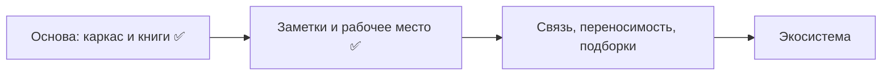

# ROADMAP — стратегия «Контекста»

Направление и порядок работ. **Целевое устройство** продукта — в `CONCEPT.md`,
правила разработки — в `AGENTS.md`. Текущее состояние кода важнее любой таблицы:
перед задачей сверяться с репозиторием.

Статусы: ✅ сделано · 🚧 сделано частично · ⏭️ следующий шаг · 💤 отложено ·
❓ не решено.

## Видение

Инструмент исследователя книг: нелинейное чтение и заметки в одном рабочем месте.
Пользователь держит книги в нескольких библиотеках, собирает именованные рабочие
места из вкладок и ведёт общие для книги заметки, не теряя их между местами.
Точка входа приложения — список рабочих мест; библиотека и реестр заметок —
хранилища, на которые место ссылается.

## Принципы

- **Рабочее место — точка сборки.** Читалка и заметки — одно место; список
  рабочих мест — главный экран.
- **Заметки привязаны к книге, а не к вкладке.** Одна книга в разных местах даёт
  общее, пополняемое состояние.
- **Plugin-first.** Формат, источник и чтение — в плагинах; ядро не знает о
  форматах. Встроенного чтения в оболочке нет.
- **Единая дизайн-система.** Интерфейс областей принадлежит приложению.
- **Local-first.** Без облака; библиотека и заметки переносимы.
- **Простое раньше богатого.** Единообразие и предсказуемость важнее свободы
  плагинов в оформлении.

## Что сделано

- **Каркас:** plugin-system, песочница WASM, права, базовые плагины настроек и
  стора, файловая установка плагинов, служебное состояние со схемами и версиями,
  SDK каркаса.
- **Книги:** generic-источник и Calibre-совместимость, индекс на SQLite с
  миграциями, несколько библиотек, страница книги с правкой свойств, поиск,
  сортировка и фасетные фильтры, пакетные обложки.
- **Чтение:** плагины форматов EPUB, FB2, PDF, DjVu (включая текстовый слой,
  встроенные закладки и пометки), поиск по содержимому, панель свойств файла с
  кешем на диске.
- **Заметки:** наборы к книге, правка, поиск в наборе, реестр наборов с поиском,
  импорт/экспорт и приём чужого набора.
- **Рабочее место:** реестр, вкладки с позицией и масштабом, панели заметок и
  свойств, лимит вкладок, сохранение состояния.
- **Интерфейс:** единые режимы адаптивности, комбинации клавиш через общий реестр,
  две локали, четыре палитры и независимая тема чтения.
- **Обновления:** проверка ядра и стор плагинов, файловый и сетевой источники,
  SHA-256, отчёт для поддержки.

## Домены

| Домен                                                                    | Состояние |
| ------------------------------------------------------------------------ | --------- |
| Каркас, плагины, права, SDK                                              | ✅        |
| Служебные документы: схемы, метки, версии, цепочки приведения            | ✅        |
| Источники книг (generic, Calibre), индекс, несколько библиотек           | ✅        |
| Страница книги, свойства (источник + правки), поиск, сортировка, фильтры | ✅        |
| Подборки книг                                                            | ⏭️        |
| Плагины форматов чтения, поиск по книге, свойства файла                  | ✅        |
| Заметки: наборы, правка, реестр, импорт/экспорт                          | ✅        |
| Подборки заметок                                                         | ⏭️        |
| Рабочее место: реестр, вкладки, панели                                   | ✅        |
| Переносимость рабочих мест (экспорт/импорт)                              | ⏭️        |
| Устойчивый идентификатор книги (`book-identity`)                         | ❓        |
| Настройка комбинаций клавиш пользователем                                | ⏭️        |
| Темы: внешние палитры                                                    | 💤        |
| Стор: подпись пакетов                                                    | ⏭️        |
| Новые форматы, LLM-поиск                                                 | 💤        |

## Этапы

### Этап 1 — основа ✅

Каркас, базовые плагины, установка плагинов из файла; источники книг, индекс,
несколько библиотек, страница книги.

### Этап 2 — заметки и рабочее место ✅

Чтение плагинами форматов, редактор заметок, реестр наборов, вкладки и панели
рабочего места, свойства открытого файла с кешем, комбинации клавиш.

### Этап 3 — связь и переносимость ⏭️

1. **Подборки книг и заметок** — именованные подмножества, вкладки подборок.
2. **Переносимость рабочих мест** — экспорт и импорт композиции без привязки к
   чужим библиотекам.
3. **`book-identity`** — устойчивый идентификатор книги по содержимому и
   метаданным, чтобы заметки не терялись при смене файла или издания.
4. **Настройка комбинаций клавиш** — интерфейс и хранение поверх готового реестра.

**Выход:** заметки привязаны к произведению, находятся, переносятся и передаются;
библиотека пригодна как каталог.

### Этап 4 — экосистема 💤

Новые форматы чтения, подпись пакетов перед публичным сетевым стором, внешние
палитры, LLM-поиск как опциональный плагин, SDK для сторонних авторов.

## Не-цели

- Копировать Calibre; совместимость с ней — опциональный плагин.
- Облачная синхронизация и аккаунты.
- Обязательная интернет-зависимость базовых функций.
- Собственный формат книги.
- Магазин и монетизация плагинов на текущем горизонте.

## Открытые вопросы

- ❓ **Владение SQLite-индексом.** Сейчас индекс строит плагин источника, ядро
  даёт host-функции SQL; нужна явная граница владения и миграций.
- ❓ **Модель мультибиблиотечности и заметок.** Общие ли заметки для всех
  библиотек или у каждой свои.
- ❓ **Идентичность набора заметок.** Как адресуется набор при обмене
  (идентификатор, автор, версия) и как отличать свой от чужого.
- ❓ **`book-identity`.** Основной ключ и разрешение коллизий: к произведению или
  к конкретному файлу/изданию.
- ❓ **Связь «библиотека ↔ рабочее место».** Путь-вложение уже снимает
  необходимость открытой библиотеки; остаётся UX выбора.
- ❓ **LLM-стек.** Локальная модель или внешний провайдер, где живёт индекс.
