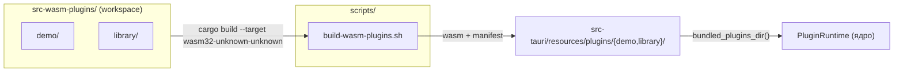

## Context

Исходники WASM-плагинов — два независимых Rust-crate (`src-tauri/demo-plugin/`,
`src-tauri/library-plugin/`), каждый со своим `Cargo.lock` и сборкой `wasm32-unknown-unknown`.
Собранные артефакты (WASM + `plugin-manifest.json`) копируются двумя скриптами в
`src-tauri/resources/plugins/{demo-plugin,library}/`. Рантайм резолвит поставляемые
ресурсы через `bundled_plugins_dir()` = `CARGO_MANIFEST_DIR/resources/plugins`
(`src-tauri/src/constants.rs`). Мотивация — в `proposal.md` (Why).

Ключевое ограничение: главный crate `jarogor_booklib` не зависит от плагинов как
от Rust-зависимостей (WASM загружаются в Extism runtime на старте), поэтому
перемещение исходников за пределы `src-tauri/` безопасно и не трогает
`src-tauri/Cargo.toml` и `Cargo.lock`. Имя demo-плагина `demo-plugin` встречается
в ядре как runtime-имя (`constants.rs` → `lib.rs`); source-плагин уже называется
`library`.

## Goals / Non-Goals

**Goals:**
- Все исходники WASM-плагинов живут в выделенной корневой директории `src-wasm-plugins/`
  за пределами `src-tauri/`.
- Суффикс `-plugin` убирается: `demo-plugin` → `demo`, `library-plugin` → `library`
  (crate, папка, WASM-модуль, имя в манифесте).
- Одна точка сборки и тестирования всех плагинов (workspace + единый скрипт).
- Внешнее поведение и рантайм-резолв ресурсов не меняются: артефакты остаются в
  `src-tauri/resources/plugins/`, точка `bundled_plugins_dir()` прежняя.

**Non-Goals:**
- Не меняются контракт v2, host-функции, точка `PluginRuntime::load` и имена
  source-плагинов; рантайм-код загрузки не реорганизуется.
- Не мигрируются уже созданные `dev_data`-библиотеки (рассматриваются как
  одноразовые, в git не входят).
- Не меняются фронтенд и Tauri-команды.

## Decisions

### 1. Cargo workspace `src-wasm-plugins/`

`src-wasm-plugins/Cargo.toml` — виртуальный workspace с `members = ["demo", "library"]`:
один общий `Cargo.lock`, один `target/`, одна команда сборки всех плагинов.
Добавление нового плагина = новый member.

> Альтернатива (отклонена): оставить независимые crate без workspace. Меньше
> связанности, но дублируются `Cargo.lock`, `target/`, логика сборки и нет
> единого входа для build/test — не соответствует цели «одна точка входа».

### 2. Переименование и перенос

| Было | Стало |
| --- | --- |
| `src-tauri/demo-plugin/` (crate `demo_plugin`) | `src-wasm-plugins/demo/` (crate `demo`) |
| `src-tauri/library-plugin/` (crate `library_plugin`) | `src-wasm-plugins/library/` (crate `library`) |
| `demo_plugin.wasm` | `demo.wasm` |
| `library_plugin.wasm` | `library.wasm` |
| `resources/plugins/demo-plugin/` (манифест `name: "demo-plugin"`) | `resources/plugins/demo/` (манифест `name: "demo"`, `module: "demo.wasm"`) |
| `resources/plugins/library/` (манифест `name: "library"`) | то же место, `module: "library.wasm"` |
| `crate-type = ["cdylib"]` (demo) | `["cdylib", "rlib"]` у обоих — чтобы `cargo test` на workspace проходил |

WASM-имя файла равно имени пакета (для `wasm32-unknown-unknown` cdylib cargo даёт
`<name>.wasm`), поэтому переименование пакета достаточно: `demo` → `demo.wasm`,
`library` → `library.wasm`.

### 3. Единый скрипт `scripts/build-wasm-plugins.sh`

Вместо двух скриптов — один: собирает workspace целиком
(`cargo build --release --target wasm32-unknown-unknown`), затем для каждого
плагина `<name>` копирует `src-wasm-plugins/target/wasm32-unknown-unknown/release/<name>.wasm`
в `src-tauri/resources/plugins/<name>/` и пишет `plugin-manifest.json`
(контент манифестов сохраняется, обновляются только `name`/`module` demo-плагина).
Старые скрипты `scripts/build-demo-plugin.sh`, `scripts/build-library-plugin.sh`
удаляются (требует согласования перед удалением).

### 4. Runtime-имя demo-плагина в ядре

Константа `DEMO_PLUGIN_DIR = "demo-plugin"` (`src-tauri/src/constants.rs`)
используется в `lib.rs` как runtime-имя плагина для проверки и вызова. При
переименовании манифеста в `demo` она переименовывается в `DEMO_PLUGIN_NAME = "demo"`
(и импорт/использования в `lib.rs`), комментарий уточняется. `LIBRARY_PLUGIN_DIR = "library"`
и `bundled_plugins_dir()` не меняются. Существующие библиотеки со старым
`plugins/demo-plugin/` не ломаются — плагин просто не вызывается по новому имени
(см. Risks).

Новая структура:

## Risks / Trade-offs

- [Старые `dev_data`-библиотеки содержат `plugins/demo-plugin/` с манифестом
  `name: "demo-plugin"`] → после переименования такой плагин не отвечает на вызов
  по имени `demo`; это безвредно (демо-плагин — служебный), `dev_data` одноразовые,
  новые библиотеки получают плагин из `resources/plugins/demo/`.
- [Общий `Cargo.lock` workspace связывает версии зависимостей обоих плагинов] →
  допустимо: набор зависимостей идентичен (`extism-pdk`, `serde`, `serde_json`);
  рассинхрон версий внутри экосистемы плагинов нежелателен в любом случае.
- [Нативная проверка workspace требует у demo `crate-type = ["cdylib", "rlib"]`] →
  rlib — хост-артефакт для тестов, на wasm-вывод cdylib не влияет; работает как
  уже у `library-plugin`.
- [Удаление старых скриптов и папок] → выполняется через `git mv`/`git rm` по
  явной договорённости (правило проекта: удаление — с разрешения).

## Migration Plan

1. `git mv` исходников в `src-wasm-plugins/{demo,library}`, правка `Cargo.toml`
   (имена пакетов, crate-type), объединение `Cargo.lock` в workspace.
2. Правка скрипта сборки и констант/`lib.rs`; пересборка артефактов
   `scripts/build-wasm-plugins.sh` → `src-tauri/resources/plugins/{demo,library}/`.
3. Обновление `_docs/` и полный прогон проверок (см. `proposal.md`).
4. Rollback: `git revert` — все изменения локальны и не затрагивают рантайм-контракт.